# 在线心理咨询平台医生服务质量监测 Agent

三人协作开发与数据适配边界见 [模块接口约定](docs/architecture/TEAM_DEVELOPMENT_CONTRACT.md)，第一次使用 GitHub 的完整操作、两人版/三人版分工和实施顺序见 [GitHub 团队协作与开发分工手册](docs/development/GITHUB_TEAM_WORKFLOW.md)。评价单位已确定为一次订单或咨询轮次：原始聊天线程先由可替换切分器形成评价轮次，不能将多年聊天线程直接当作一次咨询。该切分器及文档列出的新增契约仍待实现。

面向在线心理咨询平台运营方的 B2B 服务质检与风险线索监测系统。平台操作员导入授权的咨询记录后，后端识别初诊/复诊；复诊时检索必要的历史咨询上下文。三个专职 Agent 分别为专业服务评价 Agent（D1/D3/D6.2）、过程与响应评价 Agent（D2/D5）、共情与关系评价 Agent（D4/D6.1）。D6 两项指标默认进入评价任务，由所属 Agent 判断适用性；风险监测 Hook 仅提供可选候选线索，不控制 D6 是否执行；一个证据核验子 Agent 统一负责原文定位、评分依据核查和指标定义校对。

系统评价医生在会话中可观察到的服务行为，辅助平台扩大质检覆盖、定位问题和追溯依据。系统不对患者作临床诊断，不替代专业人员判断，也不会根据未复核的模型输出自动处罚医生或联系患者。

## Agent 工作流程

```mermaid
flowchart LR
    A[导入授权聊天记录：文本/语音/视频] --> SEG[按订单或咨询轮次切分]
    SEG --> B[多模态预处理：校验、规范化、ASR 转写、脱敏、预检]
    B --> C[初诊/复诊识别]
    C -->|复诊| D[授权检索历史咨询并分区注入]
    C -->|初诊| E[构建当前会话上下文]
    D --> E
    E --> F[风险监测 Hook：可选候选线索，不控制 D6 执行]
    F --> G[三个专职 Agent 并行评价]
    G --> H[单一证据核验 Agent：定位原文、核查评分依据、校对指标定义]
    H --> O[应用编排器：检查证据状态与分歧]
    O -->|存在待语义判断的分歧| ARB[分歧仲裁 Agent]
    O -->|无需仲裁| SCORE[确定性评分汇总]
    ARB --> O2[应用编排器：校验裁决并控制每指标一次重评]
    H -->|核验不充分| O2
    O2 -->|建议重评且额度可用| R[原评价 Agent 定向复评]
    R --> H
    O2 -->|无需重评、已解决或额度已用| SCORE
    SCORE --> M[人工复核门控]
    M --> S[总结 Agent：画像叙述、总评分说明与改进意见]
    S --> J[报告与案件构造]
    J --> K[操作员复核或归档并留审计记录]
```



评价体系沿用竞赛指标表的 6 个维度、18 项指标分布（D1/D2/D3/D4/D5/D6 分别为 2/2/5/3/4/2 项），全部通过版本化 Skill 包定义。证据核验 Agent 将复合评价拆成最小事实，分别记录支持、矛盾、证据不足、材料冲突、适用性和评分锚点状态；应用编排器控制一次定向质疑—修正，仍有语义分歧才调用仲裁 Agent。确定性评分汇总器生成 6 维质量画像与总评分（受覆盖率门槛约束），之后运行人工复核门控与总结 Agent。D6 默认纳入任务并按二级指标分工：共情与关系评价 Agent 评“风险信号回应”，专业服务评价 Agent 评“必要转介与求助提示”。历史咨询只作为有来源标签的复诊背景，评分证据必须定位到本次会话消息。

## 产品与技术结构

- **使用对象**：单平台工作空间中的一名平台质检操作员，不包含组织成员、角色或租户管理。
- **后端**：Python 3.11+、FastAPI、Pydantic 数据契约、可替换的 LLM Provider 接口和版本化 Skill。
- **前端**：规划为 Vue 3 + TypeScript 管理后台，按总览、质量监测、风险中心、复核工作台、评价任务、指标管理、数据接入和审计日志划分。
- **系统形态**：比赛 MVP 采用 FastAPI 模块化单体；前端通过版本化 HTTP API 与后端交互。

```text
.
├── app/                    # FastAPI、Agent 编排、评价规则与基础设施适配
├── frontend/               # Vue 3 后台前端目录骨架
├── data/                   # 合成演示数据与本地数据目录
└── docs/
    ├── architecture/       # Agent 与系统架构设计
    └── product/             # 后台 PRD 与后端功能说明
```

## 本地启动

需要 Python 3.11 或更高版本。

### Windows PowerShell

```powershell
py -3.11 -m venv .venv
.\.venv\Scripts\Activate.ps1
python -m pip install -e ".[dev]"
python -m uvicorn app.main:app --reload
```

### macOS / Linux

```bash
python3.11 -m venv .venv
source .venv/bin/activate
python -m pip install -e ".[dev]"
python -m uvicorn app.main:app --reload
```

启动后打开 [http://127.0.0.1:8000/health](http://127.0.0.1:8000/health)，服务应返回：

```json
{"status":"ok"}
```

### 运行测试

```bash
python -m pytest
```

测试覆盖预处理管道的阶段编排与可评价性判定、脱敏失败阻断、评价协调器的超时与失败隔离、证据引用的归一化匹配，以及注册表与账本等骨架行为，共 35 个测试；尚未覆盖三人接口约定中的完整模块连接。

`/health` 只检查 FastAPI 进程是否响应，不代表数据库、模型服务或完整评价工作流已经连通。前端目录目前仅含架构说明和目录占位文件，还没有独立安装与启动命令。

当前代码骨架已包含：FastAPI 入口与组合根装配、多模态会话数据契约（文本/语音/视频消息、ASR 转写元数据、媒体时间区间）、四阶段预处理管道（规范化 → 转写 → 脱敏 → 预检，含可评价性判定与安全阻断）、带超时与并发预算的多 Agent 协调器、共享通信池运行账本（append-only 事件/任务单/结论消息，按 run_id 隔离）、管理与情境识别 Agent 的协议占位（只产出候选路由，指派权在确定性校验）、错误隔离的 Hook 注册表、确定性证据核验工具（引文归一化匹配、媒体区间校验）、分歧仲裁 Agent 与总结 Agent 的协议占位、画像/冲突/仲裁/改进意见数据契约、评分汇总器与复核门控接口、内存仓储和 35 个契约测试。尚未实现：真实 LLM Provider 与 AgentRunner、三个正式评价 Agent 的完整执行、证据核验子 Agent、管理/分歧仲裁/总结 Agent 的完整执行、评分汇总与门控规则、复诊历史检索、风险监测 Hook 规则、持久化和后台 API。产品文档描述目标闭环，不代表上述模块都已可运行。

## 多模态输入与预处理边界

- 会话消息支持文本、语音、视频三种模态；原始音视频只保存在受控媒体存储中，**不进入模型上下文**。
- 语音/视频消息经 ASR 转写为带引擎版本与时间偏移的派生文本后才可评价；证据引用可附带媒体时间区间，供前端跳转回原始音视频位置。
- 脱敏在评价前强制执行：文本脱敏产生的映射保存在隔离仓储中，仅供审计与人工复核，不进入 Agent 输入或报告；脱敏阶段失败会阻断整条评价链路。
- 转写引擎与脱敏规则集均为可替换适配器；当前分别为"未配置显式报错"和"仅限合成演示数据"的占位实现。

## 文档

- [GitHub 团队协作与开发分工手册](docs/development/GITHUB_TEAM_WORKFLOW.md)：成员邀请、分支/PR/评审/冲突流程、公共契约规则、两人版和三人版分工及分阶段 Issues。
- [Agent 系统设计文档](docs/architecture/AGENT_SYSTEM_DESIGN.md)：Agent 模块职责、复诊历史检索、风险 Hook/D6、证据核验子 Agent、评价流转、数据契约、API、失败处理和安全设计。
- [B2B 后台架构融合提案](docs/architecture/B2B_ADMIN_CONSOLE_ARCHITECTURE.md)：后台如何融入现有项目结构，以及单操作员 MVP 的边界。
- [后台产品 PRD](docs/product/PRD_B2B_QUALITY_CONTROL_CONSOLE.md)：产品目标、用户、流程、页面、功能需求和验收标准。
- [后端 Agent 功能说明](docs/product/BACKEND_AGENT_FUNCTIONAL_SPEC.md)：后端完整业务能力、评价器职责、证据、风险复核和接口。
- [前端目录骨架说明](frontend/README.md)：Vue 3 前端模块划分和后续工程初始化约定。

## 数据与安全

- 演示优先使用合成会话；未经授权不要导入真实咨询记录。
- 不要提交 `.env`、患者身份信息、数据库文件、私有对话或本地向量索引。
- 评价结论必须与会话证据分开记录平台规则知识；引用无效或证据不足时不应给出确定分数。
- 复诊历史仅按可信匿名患者标识和平台授权检索；历史片段与本次消息分开标注，不能作为本次医生行为评分的直接证据，并需记录访问审计和执行保留/删除策略。
- 高风险结果是平台内部待核查线索；人工复核和平台处置流程保留最终判断权。

## 工程说明

仓库提供可启动的 FastAPI 服务入口和健康检查，Agent 与评价流程按模块化架构组织。真实模型供应商、持久化数据层和后台页面应在满足平台授权与安全要求后接入；当前的 `/health` 响应不代表完整质检产品已可投入运营。
