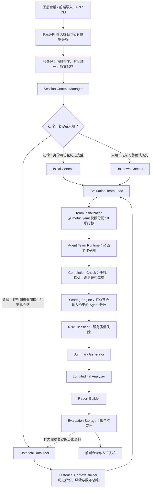
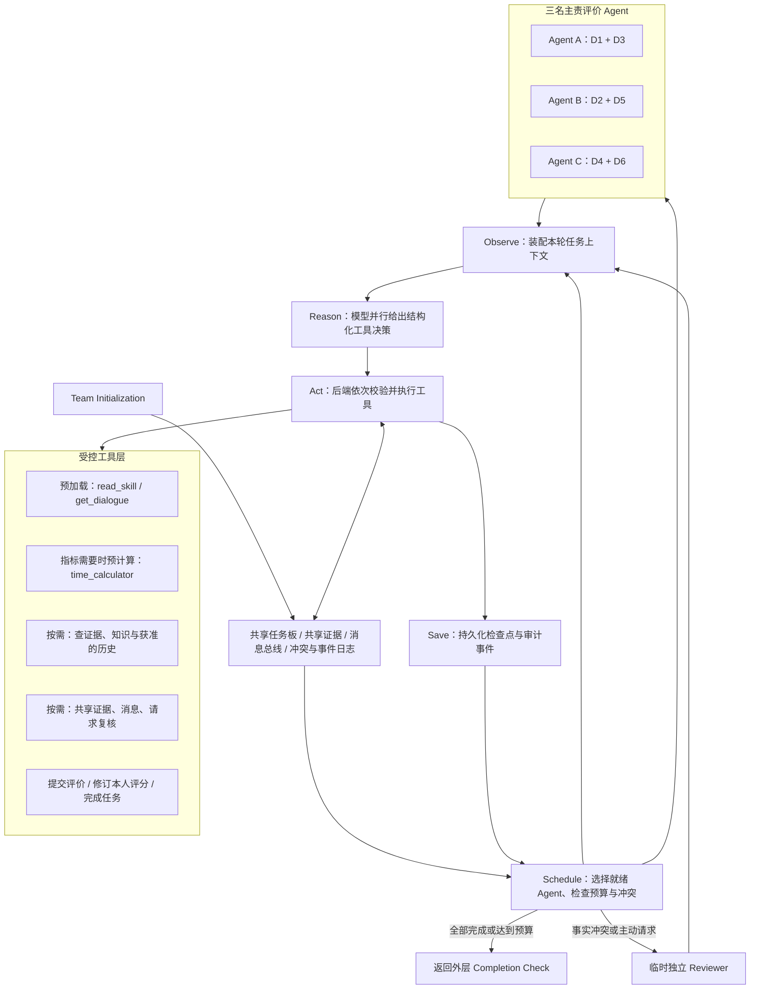

# 项目架构与文件说明

本文以当前仓库代码为准，说明系统运行链路、模块边界、目录和文件职责。新增代码时请在文件头写明“环节”和“用途”，并同步更新对应目录说明。

## Agent 架构：外层评价流程

复诊分支并不自动把旧分数交给评价 Agent：常规观察只给会话类型与历史可用性；只有指标允许、且 Agent 说明理由时，`get_previous_evaluations` 才返回受限历史事实。`UNKNOWN` 是独立状态，不推定为初诊。这里的风险分级指**医生服务质量风险**，不等同于患者临床风险判断。

## Agent 架构：内层团队循环

`read_skill` 是项目中的规则加载工具，相当于常说的 load-skill；现行运行时会在首轮推理前自动加载。`time_calculator` 在负责指标的 `metric.yaml` 声明为必需工具时预计算首次回复与相邻回复间隔，缺乏可靠时间起点时不生成首次回复数字。模型负责选择受控动作，后端负责工具权限、输入约束、预算、评分与存储；独立 Evidence Validator 已移除，模型内部推理文本不作为证据。

PostgreSQL 保存会话索引、评价报告、团队任务和审计；配置 Bucket 时，会话原文及运行快照加密压缩后存入 Bucket，PostgreSQL 保留对象引用。外层和内层都在节点边界保存检查点，支持失败后的恢复。

## 后端执行顺序

1. API/CLI 接收会话，验证输入和访问权限；组合根注入仓储、模型网关和指标目录。
2. 预处理会话文本及时间，再按可信身份、会话时间和历史导入完整性判断初诊、复诊或未知。
3. 复诊时只查询相同患者与医生、严格早于当前会话的数据；历史背景与当前证据分开保存，常规评分 Agent 不直接读取历史分数。
4. Team Lead 根据指标目录和 `app/rubrics/groups.py` 初始化主责任务：D1+D3、D2+D5、D4+D6 各由一名 Evaluator 负责。Agent 团队在共享任务板、证据池、消息总线和会话上下文上自主协作；指标原始维度仍保留用于评分和历史比较。
5. 完成度检查后，直接从符合提交约束的 Agent 结果汇总分数；然后依次执行服务风险分级、总结、跨会话分析和报告存储。
6. API 提供会话、报告、运行阶段和审计数据；前端负责查询、呈现和人工复核入口。

## 模块边界

| 模块 | 所属环节 | 职责与边界 |
|---|---|---|
| `app/api` | 接入 | HTTP 路由、认证、请求/响应；不承载评分策略 |
| `app/domain` | 核心契约 | 输入、结果、工具和端口定义；不依赖 Web 框架或数据库驱动 |
| `app/context` | 会话上下文 | 规范化、初复诊路由、历史上下文构建 |
| `app/rubrics` | 评价规则 | 加载 18 个指标、技能说明、样例及规则快照 |
| `app/team` | Agent 团队运行 | 子图调度、任务/证据/消息状态、工具执行和冲突复核 |
| `app/evaluation` | 结果后处理 | 综合评分、风险、报告、总结与纵向分析 |
| `app/workflow` | 总体编排 | 外层 LangGraph 顺序、恢复、超时和阶段持久化 |
| `app/infrastructure` | 外部适配器 | 模型网关、PostgreSQL/SQLite 仓储、加密 Bucket 对象存储、用量遥测 |
| `frontend/src` | 操作工作台 | 会话与报告呈现、趋势/指标图表、复核与 API 客户端 |

依赖方向为：API → 组合根 → Workflow → Context / Team / Evaluation → Domain Ports；Infrastructure 实现 Domain Ports 并由组合根注入。更细的维护约束见 [MODULES.md](MODULES.md)。

## 目录、文件与用途清单

### 仓库根目录

| 路径 | 所在环节与用途 |
|---|---|
| `README.md` | 项目入口：本地运行、系统流程、指标规则、API、存储和 Railway 部署说明。 |
| `docs/` | 架构与开发维护文档。 |
| `docs/PROJECT_ARCHITECTURE.md` | 本文件：系统流程图、模块边界和源码/配置文件地图。 |
| `docs/MODULES.md` | 模块维护契约：依赖方向、调整入口、状态所有权、恢复契约和测试划分。 |
| `app/` | FastAPI 后端及当前随服务提供的前端构建产物。 |
| `frontend/` | Vue 3 + TypeScript 前端源代码、测试和构建配置。 |
| `data/` | 输入样本、数据导出工具及本地/私有运行数据；真实数据不应提交或部署进镜像。 |
| `examples/` | 供 CLI、测试和开发者试跑的合成会话与指标样例。 |
| `scripts/` | 本地启动、真实样本整理等运维辅助脚本。 |
| `tests/` | 后端工作流、API、策略和 PostgreSQL 集成测试。 |
| `.github/` | CI 工作流和 PR 模板。 |
| `.env.example` | 后端环境变量模板；不含真实密钥。实际 `.env` 属于本机秘密配置。 |
| `.dockerignore` | 控制 Docker 构建上下文，排除环境、缓存和本地数据。 |
| `.gitignore` | 控制版本管理忽略规则，避免提交密钥、生成物和本地样本。 |
| `Dockerfile` | 构建后端容器并启动 ASGI 应用。 |
| `pyproject.toml` | Python 包、依赖、格式检查和测试工具配置。 |
| `requirements.txt` | Python 运行依赖列表（与 pyproject 的依赖定义配合使用）。 |
| `railway.toml` | Railway 构建/启动和健康检查配置。 |
| `frontend-preview.html` | 早期独立预览入口；正式界面以 `frontend/` 为源，部署由后端静态挂载提供。 |
| `.backend-backups/` | 后端迁移过程中保留的备份；不是运行时加载目录。 |
| `.venv/`、`*.egg-info/`、`.pytest*`、`.ruff_cache/` | 本地依赖、包元数据和测试/静态检查缓存；均为生成目录，不是业务源码。 |

### 后端 Python 文件

| 路径 | 所在环节与用途 |
|---|---|
| `app/main.py` | 服务入口：创建 FastAPI 应用、生命周期和静态前端挂载。 |
| `app/bootstrap.py` | 组合根：组装 Settings、Repository、ModelGateway、SkillCatalog 和 EvaluationService。 |
| `app/config.py` | 配置层：环境变量、模型/数据库连接、规则路径和预算参数。 |
| `app/cli.py` | 运维入口：检查配置、执行单会话评价和恢复运行。 |
| `app/demo.py` | 提供固定合成演示会话；不用于替代真实业务导入。 |
| `app/__init__.py` | 声明后端 Python 包。 |
| `app/api/routes.py` | 接入层：健康检查、会话、评价运行、报告、审计、复核与演示 API。 |
| `app/api/__init__.py` | 声明 API 子包。 |
| `app/domain/models.py` | 核心数据结构：会话、证据、任务、评分、风险和报告等契约。 |
| `app/domain/ports.py` | 核心端口：模型、仓储、知识源等可替换适配器接口。 |
| `app/domain/__init__.py` | 声明领域模型子包。 |
| `app/context/service.py` | 上下文层：会话清洗、初复诊判断、历史范围约束和历史上下文构建。 |
| `app/context/__init__.py` | 声明上下文子包。 |
| `app/rubrics/catalog.py` | 规则层：发现指标目录、校验发布规范、生成规则快照/版本并提供受限知识查询。 |
| `app/rubrics/payload.py` | 规则层：将指标规则裁剪为模型调用所需结构化内容，减少 token。 |
| `app/rubrics/groups.py` | 团队配置层：将原始指标维度映射到三组 Evaluator 职责；新增未映射维度会自动单独成组。 |
| `app/rubrics/__init__.py` | 声明规则子包。 |
| `app/team/runtime.py` | 团队运行时：构造 LangGraph 子图并执行 Agent 的动态自主循环。 |
| `app/team/state.py` | 团队状态：初始化任务板、共享证据、消息与 Agent 上下文。 |
| `app/team/tools.py` | 工具边界：验证并执行 Agent 可调用的证据、协作、查询和提交动作。 |
| `app/team/conflicts.py` | 团队协作：检测相反事实主张并管理独立复核状态。 |
| `app/team/__init__.py` | 声明团队子包。 |
| `app/workflow/service.py` | 外层流程：按阶段执行 LangGraph，管理超时、检查点持久化和断点恢复。 |
| `app/workflow/__init__.py` | 声明工作流子包。 |
| `app/evaluation/scoring.py` | 评分层：聚合有效指标分数并执行版本化服务风险分类。 |
| `app/evaluation/reporting.py` | 报告层：确定性总结、报告构建和跨会话纵向分析。 |
| `app/evaluation/analytics.py` | 分析层：汇总概览与评价统计数据。 |
| `app/evaluation/__init__.py` | 声明评价后处理子包。 |
| `app/infrastructure/model.py` | 模型适配器：调用配置的模型供应商并解析结构化决策。 |
| `app/infrastructure/repository.py` | 存储适配器：SQLite/PostgreSQL 数据访问、对象引用、旧行迁移、运行租约、审计和恢复快照。 |
| `app/infrastructure/object_store.py` | Bucket 适配器：将会话原文和运行快照加密压缩上传，读取时校验摘要，删除已被新快照取代的对象。 |
| `app/infrastructure/telemetry.py` | 可观测性：收集模型调用 token/字符用量等上下文指标。 |
| `app/infrastructure/__init__.py` | 声明基础设施子包。 |
| `app/web/index.html`、`app/web/assets/` | 后端静态托管的前端构建产物，由前端构建/同步脚本生成；修改界面请编辑 `frontend/src`，不要手改压缩或带 hash 资源。 |

### 评价规则包

`app/rubrics/metrics/<指标编号>/` 每个指标目录均由以下三个文件组成。它们在规则加载与 Agent 评价环节共同生效：

| 文件 | 用途 |
|---|---|
| `metric.yaml` | 机器可读的指标身份、维度、发布状态、评分锚点、证据要求和权重，是结构化评价规范来源。 |
| `SKILL.md` | 指导 Evaluator 如何观察、判定、引用证据及处理不确定情形。 |
| `examples.yaml` | 指标正反例和边界案例，帮助开发、人工理解与策略测试。 |

当前 18 个指标目录为：`D1.1`、`D1.2`、`D2.1`、`D2.2`、`D3.1`、`D3.2`、`D3.3`、`D3.4`、`D3.5`、`D4.1`、`D4.2`、`D4.3`、`D5.1`、`D5.2`、`D5.3`、`D5.4`、`D6.1`、`D6.2`。其中 D6.1、D6.2 为待专业审定的 draft，不能提交数值评分；其余 16 项为 published。改指标时应同时检查这三个文件的语义和发布状态一致性。主责 Agent 分组见 `app/rubrics/groups.py`；原始六维评分统计保持不变。

### 前端源代码与配置

| 路径 | 所在环节与用途 |
|---|---|
| `frontend/src/main.ts` | 前端入口：创建 Vue 应用并加载全局样式。 |
| `frontend/src/App.vue` | 工作台页面：组织会话列表、详情、评价报告、复核操作和访问凭据入口。 |
| `frontend/src/composables/useConsole.ts` | 页面状态逻辑：连接 API/预览数据，管理会话、报告和运行状态。 |
| `frontend/src/api/client/http.ts` | 网络客户端：统一 API 地址、鉴权头、错误解析和 HTTP 请求。 |
| `frontend/src/api/endpoints/evaluations.ts` | API 端点：封装会话、评价、报告、概览及复核请求。 |
| `frontend/src/api/contracts/consultations.ts` | TypeScript 类型：会话列表及会话详情数据契约。 |
| `frontend/src/api/contracts/evaluation.ts` | TypeScript 类型：评价、运行状态、证据、报告与 token 用量契约。 |
| `frontend/src/api/contracts/overview.ts` | TypeScript 类型：工作台概览与统计契约。 |
| `frontend/src/pages/OverviewPage.vue` | 概览页：展示服务质量指标、趋势和摘要。 |
| `frontend/src/components/conversation/ConsultationList.vue` | 会话选择组件：呈现会话列表和筛选/状态。 |
| `frontend/src/components/conversation/ConversationPanel.vue` | 会话详情组件：展示医患对话内容。 |
| `frontend/src/components/feedback/FindingDetail.vue` | 评价反馈组件：展示指标结论、证据和人工复核信息。 |
| `frontend/src/components/charts/RadarChart.vue` | 图表组件：呈现维度分布。 |
| `frontend/src/components/charts/TrendChart.vue` | 图表组件：呈现历史趋势。 |
| `frontend/src/components/base/Icon.vue` | 基础组件：统一图标渲染。 |
| `frontend/src/components/base/ScoreRing.vue` | 基础组件：圆环形式呈现分数。 |
| `frontend/src/components/base/StatusBadge.vue` | 基础组件：统一状态标签样式。 |
| `frontend/src/utils/catalog.ts` | 显示映射：指标、维度、名称和时间等目录信息。 |
| `frontend/src/utils/export.ts` | 导出工具：将报告下载为文件。 |
| `frontend/src/utils/reviewPriority.ts` | 复核逻辑：分配和比较人工处理优先级。 |
| `frontend/src/utils/trust.ts` | 展示计算：整理可信评分行及总分呈现数据。 |
| `frontend/src/data/preview.ts` | 预览数据：后端不可用时供界面预览的合成会话/报告。 |
| `frontend/src/data/overviewPreview.ts` | 预览数据：概览页合成统计数据。 |
| `frontend/src/styles/global.css` | 全局基础样式与页面布局。 |
| `frontend/src/styles/theme.css` | 设计令牌：颜色、字体和间距主题变量。 |
| `frontend/src/styles/reference.css` | 参考页面和通用展示样式。 |
| `frontend/src/styles/consultations.css` | 会话工作台专用样式。 |
| `frontend/src/assets/consultation-room.png` | 会话工作台使用的静态图片素材。 |
| `frontend/index.html` | Vite HTML 入口模板。 |
| `frontend/package.json` | 前端脚本和依赖声明。 |
| `frontend/pnpm-lock.yaml`、`frontend/pnpm-workspace.yaml` | pnpm 锁定依赖版本及工作区配置。 |
| `frontend/vite.config.ts` | Vite 开发服务器与生产构建配置。 |
| `frontend/tsconfig.json` | TypeScript 编译配置。 |
| `frontend/.env.example` | 前端环境变量模板。 |
| `frontend/README.md`、`frontend/design-notes.md` | 前端启动、实现和设计说明。 |
| `frontend/public/favicon.svg` | 浏览器标签页图标。 |
| `frontend/scripts/sync-backend.mjs` | 将生产构建输出同步至后端静态目录。 |
| `frontend/scripts/standalone.mjs` | 独立预览构建/启动辅助脚本。 |
| `frontend/scripts/check-preview.mjs` | 检查预览构建产物。 |
| `frontend/tests/unit/workbench.test.ts` | 工作台核心交互与状态行为测试。 |
| `frontend/tests/unit/trust.test.ts` | 评分可信展示及相关工具测试。 |
| `frontend/tests/unit/overview.test.ts` | 概览页统计与展示测试。 |
| `frontend/tests/unit/http.test.ts` | HTTP 客户端、鉴权和错误处理测试。 |
| `frontend/tests/unit/consultations.test.ts` | 会话列表及详情 API 行为测试。 |

### 数据、样例、脚本、测试与 CI

| 路径 | 所在环节与用途 |
|---|---|
| `data/export_longest_1000_sessions.py` | 数据准备工具：从原始数据筛选长会话用于离线分析。 |
| `data/longest_1000_sessions.json` | 大型原始会话数据输入；只供本地/受控环境使用，禁止放入 Git、前端包或公开部署。 |
| `data/sample/README.md` | 样例数据目录使用说明。 |
| `data/local/` | 本地 SQLite 数据库和报告输出目录，属于运行时生成数据。 |
| `data/private/` | 去标识化候选真实样本等受限文件，仍可能包含敏感文本，必须本地受控保存。 |
| `scripts/run_backend.ps1` | Windows 本地后端启动辅助脚本。 |
| `scripts/prepare_real_samples.py` | 从原始数据抽取、清理并检查少量真实会话样本。 |
| `examples/team-session.json` | CLI/测试可使用的合成完整会话样例。 |
| `examples/metric_skills/D4.1/metric.yaml` | 示例指标的机器可读规则。 |
| `examples/metric_skills/D4.1/SKILL.md` | 示例指标的 Agent 操作说明。 |
| `examples/metric_skills/D4.1/examples.yaml` | 示例指标的边界案例。 |
| `tests/conftest.py` | 后端 pytest fixtures、测试配置和模型替身。 |
| `tests/test_api.py` | HTTP API、认证、报告和复核行为测试。 |
| `tests/test_workflow.py` | LangGraph 团队循环、协作、验证、预算和恢复测试。 |
| `tests/test_policies.py` | 指标规范、风险策略与异常处理测试。 |
| `tests/test_quality_efficiency.py` | 评价质量及效率/调用成本行为测试。 |
| `tests/test_postgres.py` | PostgreSQL 事务及持久化集成测试；没有测试库时可跳过。 |
| `tests/__init__.py` | 声明测试 Python 包。 |
| `.github/workflows/ci.yml` | CI：后端 lint、测试及 PostgreSQL 验证。 |
| `.github/workflows/frontend.yml` | CI：前端依赖安装、类型检查、单元测试和构建。 |
| `.github/pull_request_template.md` | Pull Request 变更说明模板。 |

## 数据流与信任边界

- 真实会话从受信平台或受保护 API/CLI 输入；前端预览数据是合成样本，不能作为生产评价结果。
- 历史数据查询的主体和时间范围由可信会话确定，不能由 Agent 任意传入 session ID 扩权。
- 原文引用必须能在当前会话中核对；历史评价与当前行为证据隔离。
- `metric.yaml` 提供机器可读评分边界；Agent 提交时执行输入约束，之后直接进入评分引擎。报告注明未运行独立语义校验。
- 评分、服务风险、总结及纵向可比性由后端确定性模块控制；医院服务风险不等同患者临床风险。
- `.env`、`data/local/`、`data/private/` 与原始大数据需按敏感运行资料管理，不写入文档内容或公开仓库。

## 修改入口速查

增减指标改 `app/rubrics/metrics/`；调整会话路由改 `app/context/service.py`；调整 Agent 循环或工具改 `app/team/`；调整总流程改 `app/workflow/service.py`；调整评分和风险改 `app/evaluation/scoring.py`；换模型或数据库适配器改 `app/infrastructure/` 并在 `app/bootstrap.py` 注入；调整界面改 `frontend/src/`，再用前端构建脚本更新 `app/web/` 静态产物。
