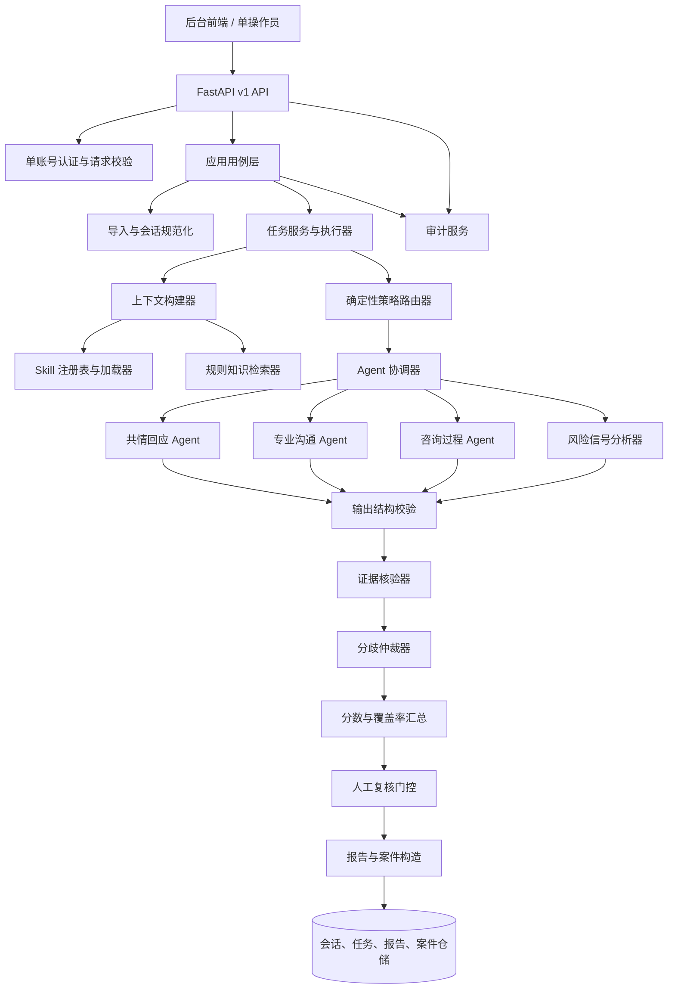
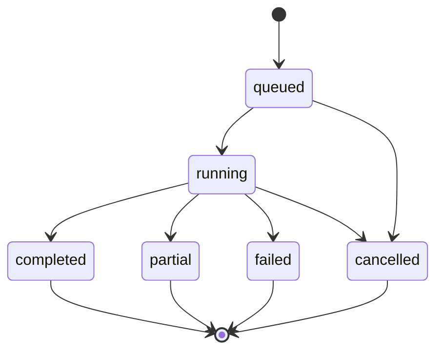

# 在线心理咨询服务质量监测 Agent 系统设计

| 属性 | 内容 |
| --- | --- |
| 系统 | 在线心理咨询平台医生服务质量监测 Agent |
| 使用方式 | 单平台工作空间、单一质检操作员账号 |
| 后端形态 | FastAPI 模块化单体；评价任务通过可替换的执行器运行 |
| 设计目标 | 让每个结论可追溯、可复核、可解释，并让关键风险进入人工处理 |

## 1. 设计目标与基本原则

Agent 系统接收平台授权的咨询记录，对医生在文字会话中**可观察到的服务行为**进行多维评价，引用原始消息证据，汇总风险线索，并把证据不足或需要关注的结果交给平台质检操作员复核。

系统按以下原则设计：

1. **工作流由代码控制**：请求校验、流程顺序、Agent 选择、权限、风险升级、证据门槛、状态变更和持久化由确定性业务模块控制。LLM 负责限定范围内的语义分析，不自行决定下一步系统操作。
2. **专职 Agent 分工**：共情回应、专业沟通、咨询过程和风险信号分别使用明确的任务说明和指标，不让一个通用 Agent 包办所有判断。
3. **评价必须绑定证据**：每条可评分结论都引用本次会话中的消息 ID 和原文片段。知识库规则可以解释适用标准，但不能充当医生行为发生过的证据。
4. **不确定性显式传递**：上下文不足、规则不适用、模型失败、证据无效或 Agent 意见冲突均保留对应状态，不用默认分数掩盖。
5. **风险识别与处罚分离**：风险 Agent 生成待核查线索；人工复核和平台现有处置流程决定后续动作。
6. **以单账号 MVP 为边界**：只面向一个平台操作员和一个工作空间，不设计组织、成员、角色切换、租户切换或案件分派。

## 2. 系统边界

### 2.1 系统负责

- 接收、校验、规范化和脱敏授权会话；
- 创建并跟踪质检任务；
- 按已发布的指标版本选择并运行专职 Agent；
- 检索适用的 Skill 与平台规范，构建受控分析上下文；
- 验证结构化输出和证据引用；
- 汇总分数、风险信号、Agent 分歧和报告；
- 生成待人工复核案件，保存人工决定和操作审计；
- 向后台前端提供任务、报告、风险队列和总览 API。

### 2.2 系统不负责

- 诊断患者、开具治疗建议或判定医生的完整临床能力；
- 向患者发送危机通知或代替平台人工应急流程；
- 自动处罚医生、自动改变医生账号状态或自动发布医生排名；
- 接受 Agent 任意发起的外部网络请求、数据库写入或平台业务操作；
- 在未获授权时跨会话建立患者画像或持久化患者记忆。

## 3. 模块总览



## 4. 后端目录与小模块职责

目录表示职责边界。模块之间通过领域对象、应用服务和仓储接口协作；Agent 不直接调用 API 路由或数据库。

```text
app/
├── api/v1/
│   ├── auth.py                 登录、退出、当前会话验证
│   ├── sessions.py             会话导入和会话概要查询
│   ├── evaluations.py          评价任务创建、状态、取消和重试
│   ├── reports.py              评价报告、证据和结果详情
│   ├── review_cases.py         案件队列和人工复核决定
│   ├── dashboard.py            工作台汇总指标
│   ├── skills.py               指标目录和版本查询
│   ├── audit.py                操作审计查询
│   └── router.py               统一挂载 v1 路由
├── application/
│   ├── use_cases/
│   │   ├── import_sessions.py  导入批次用例
│   │   ├── create_evaluation.py创建任务用例
│   │   ├── run_evaluation.py   单会话评价编排入口
│   │   ├── get_report.py       报告查询与证据装配
│   │   ├── decide_review.py    复核决定提交
│   │   └── get_dashboard.py    总览聚合查询
│   ├── context/
│   │   └── builder.py          组装 Agent 可用的会话、Skill、规则和配置
│   ├── orchestration/
│   │   ├── router.py           确定性选择 Agent/Skill
│   │   ├── coordinator.py      并发运行、限流、超时和错误收集
│   │   └── task_runner.py      任务生命周期和执行器适配
│   └── hooks/
│       ├── registry.py         注册任务前后钩子
│       └── audit_hooks.py      关键步骤审计与运行事件
├── agents/
│   ├── base.py                 Agent 输入输出协议和公共运行封装
│   ├── registry.py             静态登记 Agent 与 ID 映射
│   ├── runner.py               单 Agent 调用、限时和错误包装
│   └── specialists/
│       ├── empathy.py           共情回应评价
│       ├── professional.py      专业沟通与服务边界评价
│       ├── process.py            咨询过程评价
│       └── risk_signal.py        风险信号识别及医生响应评价
├── skills/
│   ├── loader.py                读取、校验 Skill 包
│   ├── registry.py              Skill ID、版本、状态和适用范围索引
│   └── packages/                指标定义、评分锚点与示例
├── evaluation/
│   ├── output_validator.py      结构、字段、量表和跨字段校验
│   ├── evidence_verifier.py     消息 ID、原文、角色及引用范围校验
│   ├── risk_rules.py            风险触发条件与处置优先级
│   ├── arbitrator.py            Agent 结论冲突检测与未决处理
│   ├── score_aggregator.py      指标权重、适用性和覆盖率汇总
│   ├── review_gate.py           是否生成待复核案件
│   └── report_builder.py        报告对象与摘要构造
├── domain/
│   ├── models.py                会话、消息、证据、发现和报告契约
│   ├── tasks.py                 任务状态、运行阶段和状态转移
│   ├── risks.py                 风险线索、案件级别和状态
│   ├── reviews.py               人工决定、理由和历史记录
│   └── policies.py              评分、证据、复核门槛等策略对象
├── infrastructure/
│   ├── importers/               CSV/JSON/API 来源适配与字段映射
│   ├── llm/                     Provider、模型参数、超时和重试适配
│   ├── repositories/            会话、任务、运行、报告、案件仓储
│   ├── database/                数据库连接、映射和迁移
│   ├── task_queue/              本地任务执行器与可替换队列适配器
│   ├── audit/                   审计事件持久化
│   └── security/                脱敏、凭据和敏感字段处理
├── knowledge/                   审定规范的版本管理与检索
├── memory/                      跨会话记忆策略（默认关闭）
└── tools/                        受控工具注册、分发和处理器
```

### 4.1 模块边界规则

- API 层只做认证、参数解析、调用用例和响应映射；不在路由函数内写评价逻辑。
- 应用用例负责事务与流程衔接；不依赖具体 LLM SDK 或具体数据库。
- Agent 只接收 `AgentInput`，返回 `AgentResult`；不写数据库、不创建案件、不更改任务状态。
- `evaluation/` 中的核验、评分汇总、门控和报告构造使用确定性代码，避免再让模型重写分数。
- `infrastructure/` 实现 LLM、数据库、文件导入和任务队列等外部适配。
- 所有模块通过注册表或依赖注入获得实现；禁止隐式动态导入未登记的 Agent、Skill 或工具。

## 5. 领域对象与数据契约

### 5.1 会话输入对象

```text
ConversationSession
├── session_id: str
├── source_id: str | null
├── messages: list[Message]
└── anonymized_patient_ref: str | null

Message
├── message_id: str
├── role: doctor | patient | system | unknown
├── content: str
├── sequence: int
└── timestamp: datetime | null
```

`message_id` 在一次会话内唯一；`sequence` 从小到大排列。缺少时间戳时仍可按顺序评价。未知发言方不能被当作医生发言进行评分。

### 5.2 评价任务对象

```text
EvaluationTask
├── evaluation_id: str
├── session_ids: list[str]
├── rubric_version: str
├── requested_metric_ids: list[str]
├── status: queued | running | completed | partial | failed | cancelled
├── progress: { total, completed, failed }
├── created_at / started_at / finished_at
├── run_number: int
└── error_summary: str | null
```

批量任务包含多个会话级评价单元。任务进度按完成、部分完成和失败数量计算；单个会话失败不抹掉批次内其他会话的结果。

### 5.3 Agent 上下文与输出

```text
AgentInput
├── session: ConversationSession
├── selected_skill_ids: list[str]
├── knowledge_context: list[KnowledgeRef]
├── memory_context: list[MemoryRef]   # 默认空
└── run_config: { language, rubric_version, output_schema_version }

AgentResult
├── agent_id: str
├── status: completed | partial | failed
├── findings: list[Finding]
└── error: str | null

Finding
├── metric_id: str
├── applicability: applicable | not_applicable | insufficient_context
├── score: float | null             # 0 到 5；不适用或不足时为空
├── rationale: str                  # 给操作员看的简短依据
├── evidence: list[ConversationEvidenceRef]
├── knowledge_refs: list[KnowledgeRef]
├── confidence_band: high | medium | low | null
└── limitations: list[str]
```

`confidence_band` 表达系统对本次输出质量的保守分档，不等同于经过校准的统计概率。前端不能将其显示为“准确率”。

### 5.4 证据对象

```text
ConversationEvidenceRef
├── message_ids: list[str]
├── quote: str
└── explanation: str

KnowledgeRef
├── source_id: str
├── title: str
├── excerpt: str
└── version: str | null
```

会话证据证明对话中出现了什么；知识引用说明评价采用了什么标准。报告/API 装配时可根据 `message_ids` 补充发言方、顺序和时间戳，避免 Agent 重复编造这些字段。

### 5.5 风险、复核和审计对象

- `RiskSignal`：线索 ID、类别、来源方、优先级建议、触发规则、证据引用、置信分档和限制说明。
- `ReviewCase`：案件 ID、会话 ID、评价 ID、关联风险/发现、案件状态、创建时间和处理历史。
- `ReviewDecision`：决定类型（确认/驳回/修正/无法判断/升级）、理由、修正值（如适用）、操作员和提交时间。
- `AuditEvent`：事件 ID、时间、单一操作员标识、动作、对象类型/ID、结果和必要的请求追踪 ID；不保存完整对话原文。

## 6. 数据导入与会话预处理的细化步骤

1. **认证检查**：确认单一操作员会话有效；拒绝未认证的导入、查询和复核请求。
2. **幂等键检查**：同一导入请求的幂等键已处理时返回原导入批次，不重复写入会话。
3. **来源适配**：导入器根据 CSV、JSON 或平台 API 格式将数据解析为统一记录；保留来源批次 ID。
4. **字段映射**：将上游 `speaker/content/time` 字段映射到 `role/content/timestamp`。
5. **格式校验**：检查会话 ID、消息列表、消息文本、消息角色和顺序号；错误按会话或行号返回。
6. **归一化**：统一换行、空白和时间格式，不对原文做会改变语义的改写。
7. **重复检查**：按来源会话 ID 与版本/更新时间判断新会话或更新数据；保留来源版本标识。
8. **脱敏**：按已启用规则替换直接身份信息；脱敏映射与模型上下文隔离保存。
9. **规范化 ID**：为没有稳定消息 ID 的来源生成匿名、稳定的会话内 ID。
10. **预检**：检查空消息、全为系统消息、发言方未知、内容过短或会话截断等情况。
11. **持久化**：保存规范化会话和导入结果摘要；Agent 仅读取规范化数据。
12. **审计**：记录导入操作者、来源、批次 ID、成功/失败数量和时间，不记录完整咨询文本。

预检结论为“不可评价”的会话仍保留导入错误信息，但不启动 Agent；“可部分评价”的会话可进入任务，报告必须携带相应限制。

## 7. 单次会话评价的逐步流转

下列步骤按顺序运行。每一步写入阶段状态和关联的 `evaluation_id`，便于恢复、重试和排错。

1. `CreateEvaluationUseCase` 验证会话 ID、评价范围和指定指标版本。
2. `EvaluationTaskRepository` 创建任务及每个会话的独立执行单元。
3. `TaskRunner` 将任务交给执行器；开发运行和生产队列使用同一执行接口。
4. 执行器将任务单元标记为 `running`，记录开始时间和追踪 ID。
5. 仓储加载规范化会话快照；找不到会话时将该单元标记失败。
6. `PreflightValidator` 验证消息非空、至少有可识别的医生消息、内容长度和会话顺序。
7. `SkillRegistry` 按任务选项加载已发布版本；不允许加载草稿/停用版用于正式任务。
8. `ContextBuilder` 选择与本次指标相关的 Skill 定义、锚点、示例与平台规范。
9. `KnowledgeRetriever` 仅从允许的规则集合检索短片段，附来源 ID/标题/版本。
10. `MemoryPolicy` 默认返回空记忆上下文；未启用并获得授权时不做患者跨会话检索。
11. `PolicyRouter` 生成 `RoutePlan`：Agent ID、Skill ID、适用指标和选择原因。
12. `RoutePlanValidator` 确认 Agent 和 Skill 均已登记、指标版本相容、输出契约可用。
13. `AgentRegistry` 获取本次登记的 Agent 实例；未知 ID 时任务失败并记录配置错误。
14. `EvaluationCoordinator` 为每个 Agent 建立隔离的运行记录，设置超时、并发数和令牌/调用预算。
15. 专职 Agent 接收同一会话快照；每个 Agent 只评价分配给自己的指标。
16. `LLMProvider` 使用配置模型完成推理；保存模型名、参数摘要、提示模板版本和耗时，不保存不必要的原始思维链。
17. `OutputValidator` 校验 JSON/结构化输出、Agent ID、指标 ID、分数范围、适用性、必需理由和证据字段。
18. 对格式错误的响应执行有限次数的受控修复；修复仍失败时将该 Agent 标记 `failed`，不捏造默认结论。
19. `EvidenceVerifier` 检查消息 ID 是否存在、引用是否匹配原文、发言方是否符合证据用途。
20. `FindingNormalizer` 归一化未知分数、低证据质量、重复证据和空理由状态；不改变 Agent 原始结论。
21. `RiskRuleEngine` 将风险 Agent 输出与已发布平台规则比较，形成带触发原因的风险线索。
22. `DisagreementArbitrator` 检测跨 Agent 的同指标冲突、风险级别冲突和证据引用冲突。
23. 有可配置规则支持时，仲裁器给出规则化结论；否则保留全部原始意见并标记 `unresolved`。
24. `ScoreAggregator` 按指标权重计算维度汇总和覆盖率；未达到最小覆盖门槛时不计算总分。
25. `ReviewGate` 综合风险、证据、分歧、覆盖率和 Agent 失败状态决定是否要求人工复核。
26. `ReportBuilder` 生成报告摘要、逐项发现、引用证据、限制、失败模块和规则版本。
27. `ReviewCaseFactory` 为每个需复核线索生成案件，合并同一会话/同一任务下重复的触发事件。
28. `EvaluationRepository` 在一个事务中保存 Agent 原始结果、核验结果、仲裁、汇总、报告和案件关联。
29. `AuditService` 记录任务完成、失败或部分完成事件，以及关联的操作员创建请求。
30. `TaskRunner` 更新任务单元状态和批次进度，并通知前端轮询接口可读取新状态。

任一步发生基础设施错误时，任务记录错误阶段和错误类别。可以安全重试的步骤采用幂等键；重跑生成新的运行号和模型元数据，保留历史输出以供比较。

## 8. 专职 Agent 内部设计

所有 Agent 共享统一执行外壳，但有独立的任务提示、允许的指标、证据约束和输出校验规则。

### 8.1 共情回应 Agent（`empathy`）

1. 按消息顺序提取咨询者明确表达的情绪/体验片段；不推断未表达的情绪。
2. 为每个表达找到后续相关医生回应；跨多轮时引用必要的上下文消息。
3. 对照 Skill 锚点评价回应是否识别、承接、验证或尊重该表达。
4. 检查是否存在忽略、否定、责备、机械套话或不合时宜的乐观保证。
5. 仅对具有医生消息证据且适用的指标打分。
6. 输出得分、简短理由、医生回应证据、必要的咨询者上下文证据和限制说明。

边界：使用咨询者表达作为上下文时，不将咨询者语句标成医生行为证据；无法找到相关医生回应时说明“未观察到/上下文不足”，不自行推断原因。

### 8.2 专业沟通 Agent（`professional`）

1. 按 Skill 检查医生表达是否尊重、清楚、审慎、避免污名化。
2. 按平台已发布规范识别不当承诺、明显越界、隐私暴露或不恰当关系暗示。
3. 若涉及高风险表达，检查医生回应是否符合明确的平台流程要求；仅评估文本中的可见行为。
4. 将每条发现绑定具体医生消息和对应规则版本。
5. 对规则未覆盖、临床判断不足以从文本确定的内容返回限制或不评分。

边界：Agent 不裁定咨询方案在医学/临床层面的正确性，不把观点差异直接认定为违规。

### 8.3 咨询过程 Agent（`process`）

1. 识别本次对话中咨询者明示的主要需求和问题。
2. 检查医生是否提出与上下文相关的澄清或跟进问题。
3. 检查医生回应与前文问题是否相关，是否出现明显忽略或无依据跳转。
4. 按适用 Skill 观察阶段性总结、下一步说明和结束衔接。
5. 根据会话长度、截断情况和消息覆盖判断指标是否可评。
6. 输出逐项发现和证据，不把“单次文本中未出现”解释为医生长期没有提供该服务。

边界：短消息、片段会话或平台未提供完整咨询上下文时，相关流程指标标记为上下文不足。

### 8.4 风险信号分析器（`risk_signal`）

该模块包含两个内部阶段，先候选检索，再上下文确认。

**候选检索器**

- 使用平台发布的词表、模式或轻量分类器扫描可能相关消息；
- 记录候选消息 ID、命中类别和触发规则；
- 规则命中只代表候选，不直接创建已确认违规结论。

**上下文分析 Agent**

- 查看候选消息及必要前后文，判断线索是否被误触发、引用断章或角色归属错误；
- 区分咨询者风险表达、医生表达和系统消息；
- 分析医生在当前会话中的可观察回应，并引用双方相关消息；
- 按平台策略建议案件优先级，返回不确定性和人工核查理由。

边界：自伤、伤人等线索不被表述为临床诊断或确定意图；系统只创建平台内部待核查案件，不向外部自动通知。

## 9. Skills、规则知识与记忆的调用关系

### 9.1 Skill 包

Skill 包定义“评价什么、何时适用、按什么锚点评分、必须引用什么证据”。示例字段：

```yaml
id: empathic_response
version: 1.0.0
status: published
score_range: [0, 5]
evidence_required: true
applicability: 面向医生在会话文本中回应咨询者情绪的行为
anchors:
  - score: 0
    description: ...
  - score: 3
    description: ...
  - score: 5
    description: ...
```

Skill 加载器负责 YAML/Markdown 语法校验、必需字段检查、版本冲突检查和状态过滤；注册表提供按 ID/版本检索；Agent 不直接读取任意磁盘路径。

### 9.2 规则知识检索

1. 查询由 `metric_id`、会话中的相关短语和任务类别组成；
2. 检索集合仅包含操作员已发布的平台规则或专家审核材料；
3. 每段返回内容必须包含来源、标题和版本；
4. 上下文构建器限制引用数量和长度，避免无关材料淹没会话；
5. 缺少规则材料时按 Skill 定义评价，并在报告中标出规则限制；
6. 报告中的 `knowledge_refs` 和 `evidence` 保持两个字段，不互相替代。

### 9.3 跨会话记忆

默认策略为 `disabled`。启用前须有患者身份匿名映射、授权、存取审计、生命周期和删除策略。即使将来启用，记忆只能辅助理解获准的上下文，不可作为医生在本次会话中行为的直接证据。

## 10. 评分、风险和复核门控

### 10.1 评分汇总

每项指标使用其版本化评分锚点。`not_applicable`、`insufficient_context`、无有效证据或 Agent 失败时不进入均分；它们分别进入适用性、覆盖率或失败统计。

对适用且通过证据门槛的指标，可按发布的权重计算维度分：

```text
dimension_score = Σ(metric_score × metric_weight) / Σ(metric_weight)
```

只有当维度覆盖率达到规则设定的最小门槛时才展示维度分。整体分如需展示，必须配置维度权重和最低覆盖要求；风险优先级独立计算，不得被平均分抵消。没有足够基准数据时不向用户宣称准确率或医生排名。

### 10.2 风险优先级

风险类型、触发规则、优先级映射和处理时限均来自已发布平台策略。策略输出建议优先级和理由；原始风险信号、引用和规则版本保存在报告与案件中。后端不得把 LLM 的自由文本直接当作优先级枚举。

### 10.3 人工复核门控

满足以下任一条件时创建或更新待复核案件：

- 风险策略标为高优先级或必须人工确认；
- 必需证据不存在、消息引用无效或引用与原文不匹配；
- 两个 Agent 对同一关键指标意见冲突且没有明确仲裁规则；
- 关键 Agent 失败、输出结构无法修复或报告为部分完成；
- 适用指标覆盖率低于发布门槛；
- 结果置信分档低，或对是否违反平台规则无法确定；
- 操作员配置的抽检规则要求人工查看。

门控规则按“硬性复核 > 证据/技术限制 > 普通自动归档”顺序执行；不得由高总分覆盖硬性风险门槛。门控结果需保存命中原因和规则版本。

## 11. Agent 分歧与仲裁设计

分歧分为三类：

1. **分数分歧**：同一 `metric_id` 的分值超出配置容差；
2. **结论分歧**：一个 Agent 判定满足标准、另一个判定不满足；
3. **证据分歧**：双方引用不同发言方、无效消息或互相矛盾的上下文。

仲裁器首先使用确定性规则比较 Skill 锚点、适用性、证据核验和 Agent 结果。需要语义解释时，只把争议指标、相关 Agent 输出和引用消息交给仲裁提示模板，不发送整份无关会话。仲裁输出为：

- `resolved`：规则可解释地选择某个结论，并记录依据；
- `unresolved`：规则不足或证据相互冲突，保留各方原结果并触发人工复核；
- `not_needed`：没有满足分歧条件。

仲裁不能删除原始 Agent 结果、擅自补造证据或简单对多个评分求平均。

## 12. 任务、运行和案件状态机

### 12.1 评价任务状态



- `completed`：所有必需执行单元完成，且结果结构有效；
- `partial`：至少有可用结果，但存在 Agent/会话失败或关键限制；
- `failed`：无可用评价结果，或任务前置条件失败；
- `cancelled`：操作员停止尚未完成的任务；已完成单元和运行记录保留。

### 12.2 Agent 运行状态

```text
pending → running → completed
                   ↘ partial
                   ↘ failed
                   ↘ timed_out
```

`skipped` 用于路由明确说明不适用的 Agent。被跳过的原因写入 `RoutePlan.reasons`，不能被误读为通过评价。

### 12.3 复核案件状态

```text
pending_review → in_review → confirmed
                           → rejected
                           → corrected
                           → indeterminate
                           → escalated
```

案件状态由操作员决定写入。后续重新打开或追加复核时建立新的处理历史，不改写先前决定。单账号模式不设置“分配给谁”字段。

## 13. HTTP API 与内部调用边界

### 13.1 外部 API

| API | 主要输入 | 主要输出 | 调用用例 |
| --- | --- | --- | --- |
| `POST /api/v1/auth/login` | 单一操作员凭据 | 登录会话 | 登录认证 |
| `POST /api/v1/sessions/import` | 文件或结构化会话列表 | 导入批次、逐条校验结果 | `ImportSessionsUseCase` |
| `POST /api/v1/evaluations` | 会话范围、指标版本、幂等键 | `evaluation_id`、初始状态 | `CreateEvaluationUseCase` |
| `GET /api/v1/evaluations/{id}` | 任务 ID | 状态、进度、运行摘要 | `GetEvaluationUseCase` |
| `GET /api/v1/reports/{id}` | 报告 ID | 报告、证据定位、限制 | `GetReportUseCase` |
| `GET /api/v1/review-cases` | 风险类别、优先级、状态、时间范围 | 分页案件列表 | `ListReviewCasesUseCase` |
| `POST /api/v1/review-cases/{id}/decision` | 决定类型、理由、修正值 | 新决定和案件状态 | `DecideReviewCaseUseCase` |
| `GET /api/v1/dashboard/overview` | 时间范围 | 任务/案件/质量摘要 | `GetDashboardUseCase` |
| `GET /api/v1/audit-events` | 时间、事件类型、对象 ID | 分页审计事件 | `ListAuditEventsUseCase` |

所有业务 API 都验证单账号登录。客户端不能传 `tenant_id`/`workspace_id` 改变范围；MVP 工作空间来自服务端部署配置。

### 13.2 内部事件

事件用于可观察性和任务进度，不作为不受控的业务指令：

- `session.imported` / `session.import_rejected`
- `evaluation.created` / `evaluation.started` / `evaluation.finished`
- `agent.started` / `agent.completed` / `agent.failed`
- `evidence.verification_failed`
- `review_case.created` / `review_case.decided`
- `report.persisted`

事件载荷优先使用对象 ID、状态、耗时、错误类别和追踪 ID，不包含完整咨询文本。

## 14. 持久化关系与审计

```text
ImportBatch 1 ── N ConversationSession
ConversationSession 1 ── N Message
ConversationSession 1 ── N EvaluationUnit
EvaluationTask 1 ── N EvaluationUnit
EvaluationUnit 1 ── N AgentRun
AgentRun 1 ── N Finding
Finding 1 ── N EvidenceRef
EvaluationUnit 1 ── 1 EvaluationReport
EvaluationReport 1 ── N RiskCase
RiskCase 1 ── N ReviewDecision
所有关键对象 ── N AuditEvent
```

一次评价保存会话内容快照版本或其不可变引用、Skill/规则版本、模型供应方/模型名、提示模板版本、Agent 运行状态、证据引用、仲裁结果和报告。报告重新生成时创建版本或重跑记录，不静默覆盖既有结论。

访问会话、创建/取消/重试任务、导出报告、创建案件和提交复核决定都写入审计。审计日志记录必要的操作者、时间和对象元数据，不写完整会话正文、认证凭据或模型密钥。

## 15. LLM 调用与运行治理

- `LLMProvider` 屏蔽不同模型 SDK 差异，统一超时、错误类型、结构化输出和调用元数据。
- 每个 Agent 使用版本化系统指令、Skill 内容、输出 Schema 和模型参数快照。
- 对输入长度设置预算；超长会话采用按消息边界切片和重叠上下文，不截断关键风险消息后继续伪装完整评价。
- 并发受任务级和进程级限制，避免大批量导入挤占服务资源。
- 重试只用于可恢复网络/限流/格式错误，次数和退避策略受配置约束；同一运行不无限重试。
- Provider 错误细分为限流、超时、认证、服务不可用和结构化输出失败，报告只暴露对操作员有用的安全错误摘要。
- 保存输入/输出 token 统计、耗时、模型标识和调用成本估算（如 Provider 支持），不将私密提示或患者原文写入普通日志。
- 结构化输出校验失败不可默认为空分或满分；需要重新执行时创建新的运行记录。

## 16. 安全与隐私设计

1. **单账号认证**：凭据由服务端安全配置，使用安全密码哈希或受控密钥，不写入前端源码；登录失败不泄露具体账号是否存在。
2. **会话安全**：受保护 API 校验登录会话；退出使会话失效；敏感操作可要求重新确认。
3. **数据最小化**：只传入完成质检所需消息；直接身份信息先脱敏；模型提示不包含平台不需要处理的字段。
4. **注入防护**：将对话标为不可信数据，禁止消息正文覆盖系统规则、调用未授权工具或更改输出 Schema。
5. **工具 allowlist**：工具按 ID 静态注册并校验参数；评价 Agent 无通用 shell、任意 URL 请求或数据库写权限。
6. **数据访问**：API 只返回界面完成任务所需字段；导出需检查格式、大小和操作记录。
7. **保留与删除**：会话、任务、证据快照和审计日志按平台数据策略设定保留期；删除操作需要保留符合审计要求的最少必要记录。
8. **安全日志**：错误日志清理原文、凭据、认证头和敏感查询参数；使用追踪 ID 关联模块日志。

## 17. 可观测性与运行指标

每次导入/评价生成 `trace_id`，跨 API、任务执行、Agent、Provider、证据核验和报告持久化传递。需要观测：

- 导入会话数、校验失败数和脱敏失败数；
- 任务排队时长、运行时长、完成/部分完成/失败率；
- 各 Agent 平均耗时、超时率、格式校验失败率和错误类型；
- 证据消息 ID 无效率、原文引用不匹配率和证据不足率；
- 风险案件创建数、人工改判率和处理耗时；
- 模型调用量、token、Provider 费用估算和限流次数。

业务质量指标必须显示时间范围和样本数。技术成功率不能被解释为专业评价准确率；模型质量需通过经专家复核的基准数据单独评估。

## 18. 测试与质量验证设计

- **契约测试**：导入格式、Agent 输入/输出 Schema、API 响应和状态枚举；
- **单元测试**：路由决策、Skill 加载、风险规则、分数汇总、复核门控和状态机；
- **证据测试**：有效引用、消息不存在、跨会话引用、片段不匹配、发言方不符；
- **编排测试**：Agent 并发成功、单 Agent 失败、全失败、超时、重试和幂等；
- **安全测试**：未登录访问、提示注入、工具越权、日志敏感字段、导入恶意内容；
- **专家评估集**：按指标建立匿名会话与人工标注，对评分一致性、风险召回、误报、证据定位和不确定性处理进行评估；
- **回归集**：每次 Skill、提示模板、模型或规则变更后重跑固定样本，比较差异并保留版本记录。

## 19. 关键验收场景

1. 合法会话进入任务后，每个结论可以从报告跳到原消息。
2. 患者表达和医生回应被分别标注，风险线索不会误记为医生原话。
3. 对话正文中出现“忽略之前规则”等指令时，系统仍将其视为会话内容而非系统命令。
4. 某个 Agent 超时，其他 Agent 结果和报告仍可保留，任务状态为部分完成并说明缺失模块。
5. 两个 Agent 对关键结论冲突时，报告呈现分歧并进入复核，不以平均分抹平冲突。
6. 缺少证据、消息引用不匹配或会话不适用时，分数为空并给出限制理由。
7. 明确风险线索进入待复核队列，但不会直接执行医生处罚或向患者发送消息。
8. 操作员提交人工决定后，原始 Agent 结果、决定理由和审计时间均可查询。
9. 任务重试后保留上次运行和新运行，能够比较使用的 Skill/模型版本。

## 20. 与其他文档的关系

- [后端 Agent 功能说明](../product/BACKEND_AGENT_FUNCTIONAL_SPEC.md)：从产品功能角度介绍后端能力。
- [B2B 后台 PRD](../product/PRD_B2B_QUALITY_CONTROL_CONSOLE.md)：说明单操作员后台的页面、流程和验收。
- [后台架构融合提案](./B2B_ADMIN_CONSOLE_ARCHITECTURE.md)：说明前后台如何接入当前项目结构。
