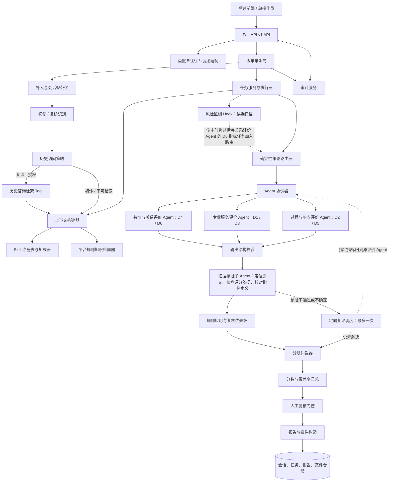
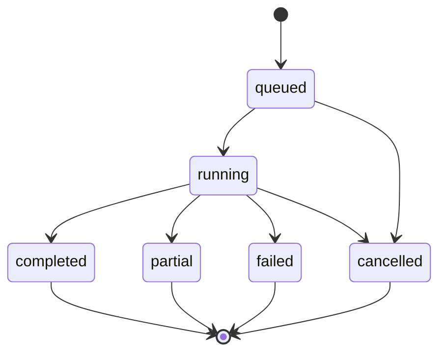

# 在线心理咨询服务质量监测 Agent 系统设计

| 属性 | 内容 |
| --- | --- |
| 系统 | 在线心理咨询平台医生服务质量监测 Agent |
| 使用方式 | 单平台工作空间、单一质检操作员账号 |
| 后端形态 | FastAPI 模块化单体；评价任务通过可替换的执行器运行 |
| 设计目标 | 让每个结论可追溯、可复核、可解释，并让关键风险进入人工处理 |

## 1. 设计目标与基本原则

Agent 系统接收平台授权的咨询记录，识别初诊/复诊；复诊时按可信匿名患者标识检索必要的历史咨询片段，并将其作为独立上下文注入评价消息。系统对医生在文字会话中**可观察到的服务行为**进行多维评价，引用原始消息证据；风险监测 Hook 命中时触发 D6 专项评价。一个证据核验子 Agent 负责定位原文证据、核查评分依据、校对指标定义，需复核的结果交给平台质检操作员。

系统按以下原则设计：

1. **工作流由代码控制**：请求校验、流程顺序、Agent 选择、权限、复核门控、证据门槛、状态变更和持久化由确定性业务模块控制。LLM 负责限定范围内的语义分析，不自行决定下一步系统操作。
2. **专职 Agent 分工**：专业服务评价 Agent 负责 D1/D3，过程与响应评价 Agent 负责 D2/D5，共情与关系评价 Agent 负责 D4/D6；D6 由风险监测 Hook 条件触发，但始终由共情与关系评价 Agent 独立评价。
3. **评价必须绑定证据**：每条可评分结论都引用本次会话中的消息 ID 和原文片段。知识库规则可以解释适用标准，但不能充当医生行为发生过的证据。
4. **不确定性显式传递**：上下文不足、规则不适用、模型失败、证据无效或 Agent 意见冲突均保留对应状态，不用默认分数掩盖。
5. **复核与处置分离**：风险 Hook 只生成候选触发并路由 D6，不直接给分或确认违规；待复核案件由核验后的评价发现和已发布平台规则生成，人工复核和平台现有处置流程决定后续动作。
6. **以单账号 MVP 为边界**：只面向一个平台操作员和一个工作空间，不设计组织、成员、角色切换、租户切换或案件分派。

## 2. 系统边界

### 2.1 系统负责

- 接收、校验、规范化和脱敏授权会话；
- 根据可信会话元数据识别初诊/复诊；复诊时检索获准的历史会话片段，并将历史上下文与本次会话消息分区注入 Agent 输入；
- 创建并跟踪质检任务；
- 按已发布的指标版本选择并运行专职 Agent；
- 在评价前运行风险监测 Hook；命中规则时将共情与关系评价 Agent 的 D6 指标任务加入本次路由计划；
- 检索适用的 Skill 与平台规范，构建受控分析上下文；
- 验证结构化输出，并调用一个证据核验子 Agent；该 Agent 内部完成原文证据定位、评分依据核查和指标定义校对；
- 汇总分数、评价发现、复核触发项、Agent 分歧和报告；
- 生成待人工复核案件，保存人工决定和操作审计；
- 向后台前端提供任务、报告、风险队列和总览 API。

### 2.2 系统不负责

- 诊断患者、开具治疗建议或判定医生的完整临床能力；
- 向患者发送危机通知或代替平台人工应急流程；
- 自动处罚医生、自动改变医生账号状态或自动发布医生排名；
- 接受 Agent 任意发起的外部网络请求、数据库写入或平台业务操作；
- 在未获授权时跨会话建立患者画像或持久化患者记忆。

## 3. 模块总览



## 4. 后端目录与小模块职责

目录表示职责边界。模块之间通过领域对象、应用服务和仓储接口协作；Agent 不直接调用 API 路由或数据库。

```text
app/
├── api/v1/
│   ├── auth.py                 登录、退出、当前会话验证
│   ├── sessions.py             会话导入和会话概要查询
│   ├── evaluations.py          评价任务创建、状态、取消和重试
│   ├── reports.py              评价报告、证据和结果详情
│   ├── review_cases.py         案件队列和人工复核决定
│   ├── dashboard.py            工作台汇总指标
│   ├── skills.py               指标目录和版本查询
│   ├── audit.py                操作审计查询
│   └── router.py               统一挂载 v1 路由
├── application/
│   ├── use_cases/
│   │   ├── import_sessions.py  导入批次用例
│   │   ├── create_evaluation.py创建任务用例
│   │   ├── run_evaluation.py   单会话评价编排入口
│   │   ├── get_report.py       报告查询与证据装配
│   │   ├── decide_review.py    复核决定提交
│   │   └── get_dashboard.py    总览聚合查询
│   ├── context/
│   │   ├── builder.py          组装当前会话、历史上下文、Skill 和规则
│   │   └── history_context.py  将历史片段以来源明确的独立消息注入 Agent 输入
│   ├── orchestration/
│   │   ├── router.py           确定性选择 Agent/Skill
│   │   ├── coordinator.py      并发运行、限流、超时和错误收集
│   │   └── task_runner.py      任务生命周期和执行器适配
│   └── hooks/
│       ├── registry.py         注册任务前后钩子
│       ├── risk_monitor.py     评价前扫描候选线索并触发 D6 路由
│       └── audit_hooks.py      关键步骤审计与运行事件
├── agents/
│   ├── base.py                 Agent 输入输出协议和公共运行封装
│   ├── registry.py             静态登记 Agent 与 ID 映射
│   ├── runner.py               单 Agent 调用、限时和错误包装
│   ├── specialists/
│   │   ├── empathy.py           共情与关系评价
│   │   ├── professional.py      专业服务与信息沟通评价
│   │   └── process.py           咨询过程与服务响应评价
│   └── subagents/
│       └── evidence_verification.py 一个 Agent 完成定位、依据核查和指标校对
├── skills/
│   ├── loader.py                读取、校验 Skill 包
│   ├── registry.py              Skill ID、版本、状态和适用范围索引
│   └── packages/                指标定义、评分锚点与示例
├── evaluation/
│   ├── output_validator.py      结构、字段、量表和跨字段校验
│   ├── evidence_verifier.py    供证据核验 Agent 调用的确定性定位工具（非独立 Agent）
│   ├── risk_rules.py            风险 Hook 规则、D6 触发及案件优先级
│   ├── arbitrator.py            Agent 结论冲突检测与未决处理
│   ├── score_aggregator.py      指标权重、适用性和覆盖率汇总
│   ├── review_gate.py           是否生成待复核案件
│   └── report_builder.py        报告对象与摘要构造
├── domain/
│   ├── models.py                会话、消息、证据、发现和报告契约
│   ├── history.py               复诊标识、历史上下文与来源引用
│   ├── tasks.py                 任务状态、运行阶段和状态转移
│   ├── risks.py                 Hook 候选、D6 评价结果、案件级别和状态
│   ├── reviews.py               人工决定、理由和历史记录
│   └── policies.py              评分、证据、复核门槛等策略对象
├── infrastructure/
│   ├── importers/               CSV/JSON/API 来源适配与字段映射
│   ├── llm/                     Provider、模型参数、超时和重试适配
│   ├── repositories/            会话、任务、运行、报告、案件仓储
│   ├── database/                数据库连接、映射和迁移
│   ├── task_queue/              本地任务执行器与可替换队列适配器
│   ├── audit/                   审计事件持久化
│   └── security/                脱敏、凭据和敏感字段处理
├── knowledge/                   审定规范的版本管理与检索
├── memory/                      复诊历史查询访问策略与最小化上下文
└── tools/                        受控工具注册、分发和处理器
```

### 4.1 模块边界规则

- API 层只做认证、参数解析、调用用例和响应映射；不在路由函数内写评价逻辑。
- 应用用例负责事务与流程衔接；不依赖具体 LLM SDK 或具体数据库。
- Agent 只接收 `AgentInput`，返回 `AgentResult`；不写数据库、不创建案件、不更改任务状态。
- `evaluation/` 提供供证据核验 Agent 使用的确定性引用定位工具，以及评分汇总、门控和报告构造；对外只有一个证据核验子 Agent，它负责组合定位检查、指标定义校对和评分依据判断，不重写原分数。
- `infrastructure/` 实现 LLM、数据库、文件导入和任务队列等外部适配。
- 所有模块通过注册表或依赖注入获得实现；禁止隐式动态导入未登记的 Agent、Skill 或工具。

## 5. 领域对象与数据契约

### 5.1 会话输入对象

```text
ConversationSession
├── session_id: str
├── source_id: str | null
├── anonymized_patient_ref: str | null
├── consultation_round: initial | follow_up | unknown
├── messages: list[Message]
└── imported_at: datetime

Message
├── message_id: str
├── role: doctor | patient | system | unknown
├── content: str
├── sequence: int
└── timestamp: datetime | null
```

`message_id` 在一次会话内唯一；`sequence` 从小到大排列。缺少时间戳时仍可按顺序评价。未知发言方不能被当作医生发言进行评分。
`consultation_round` 优先依据平台提供的可信会话元数据确定；不得通过猜测身份或仅凭文本相似度把两次会话认定为同一患者。

### 5.2 评价任务对象

```text
EvaluationTask
├── evaluation_id: str
├── session_ids: list[str]
├── rubric_version: str
├── requested_metric_ids: list[str]
├── status: queued | running | completed | partial | failed | cancelled
├── progress: { total, completed, failed }
├── created_at / started_at / finished_at
├── run_number: int
└── error_summary: str | null
```

批量任务包含多个会话级评价单元。任务进度按完成、部分完成和失败数量计算；单个会话失败不抹掉批次内其他会话的结果。

### 5.3 Agent 上下文与输出

```text
AgentInput
├── session: ConversationSession
├── history_context: HistoryContext
├── selected_skill_ids: list[str]
├── knowledge_context: list[KnowledgeRef]
├── risk_candidates: list[RiskTrigger]
└── run_config: { language, rubric_version, output_schema_version }

HistoryContext
├── status: retrieved | not_follow_up | unavailable | not_authorized
├── source_sessions: list[HistorySessionRef]
├── messages: list[HistoricalMessageRef]
└── retrieval_trace_id: str | null

HistorySessionRef
├── session_id: str
├── occurred_at: datetime | null
└── source_id: str | null

HistoricalMessageRef
├── session_id: str
├── message_id: str
├── role: doctor | patient | system | unknown
├── content: str
└── timestamp: datetime | null

AgentResult
├── agent_id: str
├── status: completed | partial | failed
├── findings: list[Finding]
└── error: str | null

Finding
├── metric_id: str
├── applicability: applicable | not_applicable | insufficient_context
├── score: float | null             # 0 到 5；不适用或不足时为空
├── rationale: str                  # 给操作员看的简短依据
├── evidence: list[ConversationEvidenceRef]
├── knowledge_refs: list[KnowledgeRef]
├── confidence_band: high | medium | low | null
└── limitations: list[str]
```

`confidence_band` 表达系统对本次输出质量的保守分档，不等同于经过校准的统计概率。前端不能将其显示为“准确率”。
`history_context` 作为单独的消息块注入 Prompt，并逐条标注历史会话 ID、时间和消息 ID；它只供理解复诊背景，不得作为本次医生服务行为的直接证据。

### 5.4 证据对象

```text
ConversationEvidenceRef
├── message_ids: list[str]
├── quote: str
└── explanation: str

KnowledgeRef
├── source_id: str
├── title: str
├── excerpt: str
└── version: str | null
```

会话证据证明对话中出现了什么；知识引用说明评价采用了什么标准。报告/API 装配时可根据 `message_ids` 补充发言方、顺序和时间戳，避免 Agent 重复编造这些字段。

### 5.5 风险、证据核验、复核和审计对象

- `RiskTrigger`：Hook 候选 ID、候选类别、命中消息 ID、发言方、触发规则及版本、命中状态（candidate/routed/evaluated/dismissed）；候选命中本身不代表违规或最终风险结论。
- `EvidenceVerificationResult`：finding ID、引用定位状态（valid/missing/quote_mismatch/source_mismatch/uncertain）、指标定义匹配状态（matched/mismatched/uncertain）、评分依据支撑状态（supported/partial/unsupported/uncertain）、引用证据、分项核验理由和 Agent 运行版本。
- `ReviewCase`：案件 ID、会话 ID、评价 ID、关联风险/发现、案件状态、创建时间和处理历史。
- `ReviewDecision`：决定类型（确认/驳回/修正/无法判断/升级）、理由、修正值（如适用）、操作员和提交时间。
- `AuditEvent`：事件 ID、时间、单一操作员标识、动作、对象类型/ID、结果和必要的请求追踪 ID；不保存完整对话原文。

## 6. 数据导入与会话预处理的细化步骤

1. **认证检查**：确认单一操作员会话有效；拒绝未认证的导入、查询和复核请求。
2. **幂等键检查**：同一导入请求的幂等键已处理时返回原导入批次，不重复写入会话。
3. **来源适配**：导入器根据 CSV、JSON 或平台 API 格式将数据解析为统一记录；保留来源批次 ID。
4. **字段映射**：将上游 `speaker/content/time` 字段映射到 `role/content/timestamp`。
5. **格式校验**：检查会话 ID、消息列表、消息文本、消息角色和顺序号；错误按会话或行号返回。
6. **归一化**：统一换行、空白和时间格式，不对原文做会改变语义的改写。
7. **重复检查**：按来源会话 ID 与版本/更新时间判断新会话或更新数据；保留来源版本标识。
8. **脱敏**：按已启用规则替换直接身份信息；脱敏映射与模型上下文隔离保存。
9. **规范化 ID**：为没有稳定消息 ID 的来源生成匿名、稳定的会话内 ID。
10. **预检**：检查空消息、全为系统消息、发言方未知、内容过短或会话截断等情况。
11. **持久化**：保存规范化会话和导入结果摘要；Agent 仅读取规范化数据。
12. **审计**：记录导入操作者、来源、批次 ID、成功/失败数量和时间，不记录完整咨询文本。

预检结论为“不可评价”的会话仍保留导入错误信息，但不启动 Agent；“可部分评价”的会话可进入任务，报告必须携带相应限制。

## 7. 单次会话评价的逐步流转

下列步骤按顺序运行。每一步写入阶段状态和关联的 `evaluation_id`，便于恢复、重试和排错。

1. `CreateEvaluationUseCase` 验证会话 ID、评价范围、指标版本和幂等键。
2. `EvaluationTaskRepository` 创建任务及每个会话的独立执行单元。
3. `TaskRunner` 将任务交给执行器；执行器记录运行状态、开始时间和追踪 ID。
4. 仓储加载规范化会话快照；找不到会话时将该单元标记失败。
5. `PreflightValidator` 校验消息、角色、顺序、时间戳和会话完整性。
6. `ConsultationRoundClassifier` 根据可信平台元数据识别初诊、复诊或未知；不通过文本相似度猜测患者身份。
7. 对复诊会话，`HistoryAccessPolicy` 校验可信匿名患者标识和平台授权；通过后调用 `HistoryRetrievalTool` 查询相关历史会话及消息片段，并记录来源、日期和检索轨迹。
8. 初诊不查历史；复诊缺少可信标识、无权读取或历史服务不可用时，明确记录原因，历史依赖指标标记为上下文不足，不伪造历史上下文。
9. `ContextBuilder` 将本次会话与 `HistoryContext` 分开组装；历史片段以带来源、日期和消息 ID 的独立 prompt message 注入，不能混入本次消息列表或作为本次医生行为证据。
10. `SkillRegistry` 加载已发布的指标版本；`KnowledgeRetriever` 只检索已发布的平台规范和专家审核材料。
11. 评价前的 `RiskMonitorHook` 扫描本次会话原始消息，保存命中消息 ID、规则/词表版本和候选类别；Hook 命中只触发共情与关系评价 Agent 的 D6 路由，不直接评分或创建已确认违规结论。
12. `PolicyRouter` 生成 `RoutePlan`：常规的 D1-D5 指标路由，以及 Hook 命中时分配给共情与关系评价 Agent 的 D6 指标任务和选择原因。
13. `RoutePlanValidator` 确认评价 Agent、证据核验子 Agent、Skill、版本和输出契约均已登记且兼容。
14. `AgentRegistry` 获取登记的专职评价 Agent 和唯一的证据核验子 Agent；未知 ID 时任务失败并记录配置错误。
15. `EvaluationCoordinator` 为各评价任务建立运行记录，设置超时、并发数和令牌/调用预算。
16. 三个评价 Agent 并行执行各自负责的指标：专业服务评价 Agent 执行 D1/D3，过程与响应评价 Agent 执行 D2/D5，共情与关系评价 Agent 执行 D4；Hook 命中时，D6 作为该共情与关系评价 Agent 内部的条件指标分支一并执行，不调用其他评价 Agent 联合打分。
17. `LLMProvider` 保存模型名、参数摘要、提示模板版本和耗时，不保存不必要的原始思维链。
18. `OutputValidator` 校验结构化输出、Agent/指标 ID、分数范围、适用性、理由和证据字段。
19. `EvidenceVerificationAgent` 对每条 Finding 运行统一核验流程：内部确定性定位工具核对消息 ID、原文片段、发言方、时间、会话归属和本次/历史来源标签；随后核对 `metric_id`、指标定义、适用条件、评分锚点和 Skill 版本；最后判断已定位的医生行为证据能否支撑评价理由与分数。
20. Agent 以一份 `EvidenceVerificationResult` 返回引用定位状态、指标定义匹配状态、评分依据支撑状态、可审阅理由和所需补充证据；任一环节无效、错配、不支撑或不确定，都明确标记原因。
21. 若证据核验 Agent 输出不支撑、不确定或指标定义不匹配，`TargetedReviewDispatcher` 将争议指标、原始 Finding 和必要上下文退回原评价 Agent 定向复评，最多一次；复评结果由同一个证据核验 Agent 再次完整核验。
22. 复评后仍不充分的 Finding 保留原结果并标记 `unresolved`，进入人工复核，不通过反复调用模型强行得到确定结论。
23. `RiskRuleEngine` 将 Hook 候选与共情与关系评价 Agent 输出且已核验的 D6 结果、已发布平台规则关联，确定案件类别与优先级；没有 D6 的核验结果时，Hook 命中仍只是候选。
24. `DisagreementArbitrator` 检测同指标评价、复核优先级和证据引用方面的冲突；无法按规则解决时保留全部意见。D6 不存在跨评价 Agent 的联合打分或分歧仲裁。
25. `ScoreAggregator` 按版本化指标权重计算维度分和覆盖率；未达到覆盖门槛时不计算总分。
26. `ReviewGate` 综合 Hook/D6 结果、证据状态、分歧、覆盖率和 Agent 失败状态决定是否人工复核。
27. `ReportBuilder` 生成逐项发现、当前及历史上下文来源、证据核验结果、风险触发记录、限制和版本信息。
28. `ReviewCaseFactory` 为需复核的评价发现创建案件；候选 Hook、D6 结果、证据和规则版本均保留关联。
29. `EvaluationRepository` 在一个事务中保存运行、历史上下文引用、核验、仲裁、汇总、报告和案件关联。
30. `AuditService` 记录历史查询、Hook 命中、Agent/子 Agent 运行、任务完成/失败和操作员请求；审计日志不保存不必要的完整咨询正文。
31. `TaskRunner` 更新任务单元和批次进度，并通知前端轮询接口可读取新状态。

任一步发生基础设施错误时，任务记录错误阶段和错误类别。可以安全重试的步骤采用幂等键；重跑生成新的运行号和模型元数据，保留历史输出以供比较。

## 8. 专职 Agent 与子 Agent 内部设计

评价由三个专职 Agent 承担：专业服务评价 Agent 负责 D1/D3，过程与响应评价 Agent 负责 D2/D5，共情与关系评价 Agent 负责 D4/D6。D6 仅在风险监测 Hook 命中时作为共情与关系评价 Agent 的条件指标分支执行，不另设 D6 Agent，也不由其他评价 Agent 联合打分。每条 Finding 生成后由一个证据核验子 Agent 依次完成原文定位、评分依据核查和指标定义校对。所有 Agent 共享统一执行外壳，但具有独立任务提示、指标范围、证据约束和输出契约。

| 指标 | 名称 | 评价主体 | 评价范围 |
| --- | --- | --- | --- |
| D1 | 服务可靠性 | 专业服务评价 Agent | 可观察的服务履行、同次咨询一致性；复诊时可参考带来源的既往服务记录 |
| D2 | 服务响应性 | 过程与响应评价 Agent + 时间计算 Tool | 首次回复和轮次间响应间隔，以消息时间戳计算 |
| D3 | 专业信息沟通 | 专业服务评价 Agent | 关键诉求回应、必要背景询问、信息表达清晰度 |
| D4 | 情感共情性 | 共情与关系评价 Agent | 情绪识别、回应贴合度、尊重与非评判性 |
| D5 | 咨询协作性 | 过程与响应评价 Agent | 目标协商、意见征询、个体化沟通和可执行的下一步 |
| D6 | 心理风险应对 | 共情与关系评价 Agent；由 Hook 条件触发 | 按 D6 指标评价风险信号回应、必要转介与求助提示；结合对话上下文核对表达归属和医生回应 |

六项指标是当前方案的业务指标集合；最终评分锚点、适用条件和权重仍由版本化 Skill 与平台规则发布，不把指标名本身当成评分标准。

### 8.1 共情与关系评价 Agent（`empathy`）

1. 按消息顺序提取咨询者明确表达的情绪/体验片段；不推断未表达的情绪。
2. 为每个表达找到后续相关医生回应；跨多轮时引用必要的上下文消息。
3. 对照 Skill 锚点评价回应是否识别、承接、验证或尊重该表达。
4. 检查是否存在忽略、否定、责备、机械套话或不合时宜的乐观保证。
5. 仅对具有医生消息证据且适用的指标打分。
6. 输出得分、简短理由、医生回应证据、必要的咨询者上下文证据和限制说明。

该 Agent 负责 D4 情感共情性和 D6 心理风险应对。D6 仅在 Hook 命中后执行，由本 Agent 独立完成：结合 D6 Skill 判断本次会话中的风险信号回应、必要转介与求助提示是否符合平台发布的评价标准，并核对表达归属、上下文含义及医生回应。咨询者表达仅用于解释情境，不作为医生服务行为的负面证据。

边界：使用咨询者表达作为上下文时，不将咨询者语句标成医生行为证据；无法找到相关医生回应时说明“未观察到/上下文不足”，不自行推断原因。

### 8.2 专业服务评价 Agent（`professional`）

1. 负责 D1 服务可靠性：只基于可见记录评价服务是否履行已说明的流程、同次咨询前后是否一致；复诊时可参考已检索的历史承诺或服务记录，但必须标明历史来源。
2. 负责 D3 专业信息沟通：观察医生是否围绕咨询者明示的问题作回应、是否清晰说明信息、是否询问与服务流程相关的症状或背景。
3. 按平台已发布规范识别不当承诺、明显越界、隐私暴露或不恰当关系暗示。
4. 将每条发现绑定本次医生消息、适用 Skill 和规则版本；历史记录仅作背景并单独标注。
5. 对规则未覆盖、临床判断不足以从文本确定的内容返回限制或不评分。

边界：Agent 不裁定咨询方案在医学/临床层面的正确性，不把观点差异直接认定为违规。

### 8.3 过程与响应评价 Agent（`process`）

1. 负责 D2 服务响应性：使用消息时间戳计算首次回复和轮次间响应间隔；时间计算由确定性 Tool 完成，Agent 不估算缺失时间。
2. 负责 D5 咨询协作性：观察医生是否与咨询者澄清目标、征询意见、根据本次对话个体化沟通并说明可执行的下一步。
3. 检查医生回应与前文问题是否相关，是否出现明显忽略或无依据跳转。
4. 按适用 Skill 观察阶段性总结、下一步说明和结束衔接。
5. 根据会话长度、截断情况和时间戳覆盖判断指标是否可评。
6. 输出逐项发现和证据，不把“单次文本中未出现”解释为医生长期没有提供该服务。

边界：短消息、片段会话或平台未提供完整咨询上下文时，相关流程指标标记为上下文不足。

### 8.4 风险监测 Hook 与 D6 条件路由

**风险监测 Hook（`risk_monitor`）**

- 在常规评价前扫描本次会话消息，使用平台发布的词表、模式或轻量分类器产生候选触发；
- 记录候选消息 ID、发言方、命中类别、触发规则 ID/版本和扫描状态；
- 命中只用于把共情与关系评价 Agent 的 D6 指标任务加入 `RoutePlan`，不自行评分、不确认违规、不单独创建案件；
- 不扫描或检索历史会话来扩张本次 Hook 命中范围；历史内容只作为复诊上下文。

**D6 心理风险应对（共情与关系评价 Agent 的条件指标）**

- Hook 命中后，将候选消息及必要的本次会话前后文交给共情与关系评价 Agent 的 D6 分支；其他评价 Agent 不参与 D6 评分；
- 该 Agent 依据 D6 Skill 评价风险信号回应、必要转介与求助提示，核对发言角色、上下文含义，并引用相关咨询者消息和医生回应；
- 输出 D6 发现、证据、不确定性和适用限制。咨询者表达只用于解释情境，不被直接作为医生行为证据，也不对咨询者作临床诊断或确定意图判断；
- `RiskRuleEngine` 只对 D6 核验后的发现应用平台案件类别和优先级策略；Hook 命中本身不作为确定性结论。

边界：该流程识别的是平台定义的待核查服务线索，不构成临床诊断或确定意图判断；不向咨询者发送自动通知，不替代平台人工应急流程。

### 8.5 证据核验子 Agent（`evidence_verification`）

每条 Finding 只调用一个证据核验子 Agent。输入包括本次会话、明确标记的历史上下文、对应指标 Skill/版本、评价 Finding 和引用信息。Agent 将内部工具校验与语义判断编排成一次完整核验，对外只返回一份统一结果。

1. **原文证据定位**：调用确定性定位工具核对消息 ID 是否存在、引文是否匹配原文、发言方与时间是否正确、消息属于本次会话还是历史背景；历史内容不能伪装为本次医生行为证据。确定性工具是 Agent 的内部工具，不是另一个 Agent。
2. **指标定义校对**：核对 Finding 的 `metric_id` 和名称是否一致，所引用 Skill 版本是否正确，指标定义、适用条件与评分锚点是否匹配；发现错用指标、规则版本或适用范围时标记不匹配并说明依据。
3. **评分依据核查**：判断已定位的证据是否与该指标相关、是否确实支持评价理由与分数，检查是否把咨询者表达错当医生行为、从历史上下文推断当前行为，或作出超出文本证据的结论。
4. **统一返回核验结果**：为定位、指标匹配和评分支撑分别返回状态与理由，并形成总状态；至少包括 `supported`、`partial`、`unsupported`、`uncertain`，且附上需要人工查看或定向复评的原因。
5. Agent 不重写原始评价、不直接修改分数、不补造证据或改写指标规则。核验不充分时，由编排器将相关 Finding 退回原评价 Agent 定向复评一次；复评后仍不充分则进入人工复核。

## 9. Skills、规则知识与复诊历史的调用关系

### 9.1 Skill 包

Skill 包定义“评价什么、何时适用、按什么锚点评分、必须引用什么证据”。示例字段：

```yaml
id: empathic_response
version: 1.0.0
status: published
score_range: [0, 5]
evidence_required: true
applicability: 面向医生在会话文本中回应咨询者情绪的行为
anchors:
  - score: 0
    description: ...
  - score: 3
    description: ...
  - score: 5
    description: ...
```

Skill 加载器负责 YAML/Markdown 语法校验、必需字段检查、版本冲突检查和状态过滤；注册表提供按 ID/版本检索；Agent 不直接读取任意磁盘路径。

### 9.2 规则知识检索

1. 查询由 `metric_id`、会话中的相关短语和任务类别组成；
2. 检索集合仅包含操作员已发布的平台规则或专家审核材料；
3. 每段返回内容必须包含来源、标题和版本；
4. 上下文构建器限制引用数量和长度，避免无关材料淹没会话；
5. 缺少规则材料时按 Skill 定义评价，并在报告中标出规则限制；
6. 报告中的 `knowledge_refs` 和 `evidence` 保持两个字段，不互相替代。

### 9.3 复诊历史咨询检索

初诊不调用历史检索；复诊必须先通过 `HistoryAccessPolicy` 校验可信匿名患者标识、平台授权和当前操作范围，再由 `HistoryRetrievalTool` 从历史咨询库检索与本次评价相关的有限片段。检索返回历史会话 ID、日期、消息 ID、来源和命中原因，写入审计事件。

`HistoryContextBuilder` 将这些片段作为独立 prompt message 注入 Agent 输入，并在 UI、日志和结果 Schema 中持续标注为“历史上下文”。历史消息可用于判断服务连续性、已说明的计划和沟通一致性；不能作为本次医生发言或本次评价结论的直接证据。无可信患者标识、授权不足或检索失败时，不猜测身份或使用其他会话，历史依赖指标标为上下文不足；不依赖历史的指标仍可评价。

## 10. 评分、风险和复核门控

### 10.1 评分汇总

每项指标使用其版本化评分锚点。`not_applicable`、`insufficient_context`、无有效证据或 Agent 失败时不进入均分；它们分别进入适用性、覆盖率或失败统计。

对适用且通过证据门槛的指标，可按发布的权重计算维度分：

```text
dimension_score = Σ(metric_score × metric_weight) / Σ(metric_weight)
```

只有当维度覆盖率达到规则设定的最小门槛时才展示维度分。整体分如需展示，必须配置维度权重和最低覆盖要求；风险案件优先级独立计算，不得被平均分抵消。没有足够基准数据时不向用户宣称准确率或医生排名。

### 10.2 风险 Hook 与复核案件优先级

Hook 命中记录候选类别、消息、规则 ID 和规则版本，并将共情与关系评价 Agent 的 D6 指标加入任务；它不直接设置分数或案件等级。D6 结果经证据核验后，`RiskRuleEngine` 才能按已发布平台策略确定案件类别、优先级映射和处理时限。后端不得把 LLM 自由文本或 Hook 命中本身直接当作优先级枚举。

### 10.3 人工复核门控

满足以下任一条件时创建或更新待复核案件：

- 风险策略标为高优先级或必须人工确认；
- Hook 候选经共情与关系评价 Agent 的 D6 评价和规则处理后达到平台复核条件；
- 共情与关系评价 Agent 的 D6 评价失败，或 D6 证据核验仍未解决；
- 必需证据不存在、消息引用无效或引用与原文不匹配；
- 证据核验 Agent 的总体状态为 `unsupported`/`uncertain` 或指标定义不匹配，且一次定向复评后仍未解决；
- 初评、定向复评、证据核验或平台规则之间存在未解决冲突；
- 关键 Agent 失败、输出结构无法修复或报告为部分完成；
- 适用指标覆盖率低于发布门槛；
- 结果置信分档低，或对是否违反平台规则无法确定；
- 操作员配置的抽检规则要求人工查看。

门控规则按“硬性复核 > 证据/技术限制 > 普通自动归档”顺序执行；不得由高总分覆盖硬性风险门槛。门控结果需保存 Hook、D6、证据核验和规则命中原因及版本。

## 11. Agent 分歧与仲裁设计

每个指标只分配给一个专职评价 Agent，因此仲裁器不让多个评价 Agent 对同一指标重复打分。它处理三个阶段之间的冲突：

1. **证据支撑冲突**：评价 Finding 与证据核验子 Agent 的 `supported/partial/unsupported/uncertain` 判断不一致；
2. **复评冲突**：定向复评结果与原始 Finding 不一致；
3. **规则适用冲突**：评价结论与确定性平台规则的适用结果不一致。

仲裁器首先使用确定性规则比较 Skill 锚点、适用性、证据核验和原始/复评结果。需要语义解释时，只把争议指标、相关 Finding、证据核验意见、平台规则和引用消息交给仲裁提示模板，不发送整份无关会话。仲裁输出为：

- `resolved`：规则可解释地选择某个结论，并记录依据；
- `unresolved`：规则不足或证据相互冲突，保留各方原结果并触发人工复核；
- `not_needed`：没有满足分歧条件。

证据核验子 Agent 返回 `unsupported` 或 `uncertain` 时，先尝试一次只针对相关指标的复评；仍未解决时仲裁器保留原始与复评结果并触发人工复核。复评不重跑无关指标，也不能把历史咨询片段改造成当前会话证据。仲裁不能删除原始 Agent 结果、擅自补造证据或简单对多个评分求平均。

## 12. 任务、运行和案件状态机

### 12.1 评价任务状态



- `completed`：所有必需执行单元完成，且结果结构有效；
- `partial`：至少有可用结果，但存在 Agent/会话失败或关键限制；
- `failed`：无可用评价结果，或任务前置条件失败；
- `cancelled`：操作员停止尚未完成的任务；已完成单元和运行记录保留。

### 12.2 Agent 运行状态

```text
pending → running → completed
                   ↘ partial
                   ↘ failed
                   ↘ timed_out
```

`skipped` 用于路由明确说明不适用的 Agent。被跳过的原因写入 `RoutePlan.reasons`，不能被误读为通过评价。

### 12.3 复核案件状态

```text
pending_review → in_review → confirmed
                           → rejected
                           → corrected
                           → indeterminate
                           → escalated
```

案件状态由操作员决定写入。后续重新打开或追加复核时建立新的处理历史，不改写先前决定。单账号模式不设置“分配给谁”字段。

## 13. HTTP API 与内部调用边界

### 13.1 外部 API

| API | 主要输入 | 主要输出 | 调用用例 |
| --- | --- | --- | --- |
| `POST /api/v1/auth/login` | 单一操作员凭据 | 登录会话 | 登录认证 |
| `POST /api/v1/sessions/import` | 文件或结构化会话列表 | 导入批次、逐条校验结果 | `ImportSessionsUseCase` |
| `POST /api/v1/evaluations` | 会话范围、指标版本、幂等键 | `evaluation_id`、初始状态 | `CreateEvaluationUseCase` |
| `GET /api/v1/evaluations/{id}` | 任务 ID | 状态、进度、运行摘要 | `GetEvaluationUseCase` |
| `GET /api/v1/reports/{id}` | 报告 ID | 报告、证据定位、限制 | `GetReportUseCase` |
| `GET /api/v1/review-cases` | 风险类别、优先级、状态、时间范围 | 分页案件列表 | `ListReviewCasesUseCase` |
| `POST /api/v1/review-cases/{id}/decision` | 决定类型、理由、修正值 | 新决定和案件状态 | `DecideReviewCaseUseCase` |
| `GET /api/v1/dashboard/overview` | 时间范围 | 任务/案件/质量摘要 | `GetDashboardUseCase` |
| `GET /api/v1/audit-events` | 时间、事件类型、对象 ID | 分页审计事件 | `ListAuditEventsUseCase` |

所有业务 API 都验证单账号登录。客户端不能传 `tenant_id`/`workspace_id` 改变范围；MVP 工作空间来自服务端部署配置。

### 13.2 内部事件

事件用于可观察性和任务进度，不作为不受控的业务指令：

- `session.imported` / `session.import_rejected`
- `evaluation.created` / `evaluation.started` / `evaluation.finished`
- `agent.started` / `agent.completed` / `agent.failed`
- `history.retrieval.started` / `history.retrieval.completed` / `history.retrieval.denied`
- `risk_hook.candidate_detected` / `risk_hook.no_match`
- `d6.started` / `d6.completed` / `d6.failed`
- `evidence_verification.started` / `evidence_verification.completed` / `evidence_verification.failed`
- `evidence.reference_check_failed` / `evidence.targeted_review_requested`
- `review_case.created` / `review_case.decided`
- `report.persisted`

事件载荷优先使用对象 ID、状态、耗时、错误类别和追踪 ID，不包含完整咨询文本。

## 14. 持久化关系与审计

```text
ImportBatch 1 ── N ConversationSession
ConversationSession 1 ── N Message
ConversationSession 1 ── N HistoryContextRef
ConversationSession 1 ── N EvaluationUnit
EvaluationTask 1 ── N EvaluationUnit
EvaluationUnit 1 ── N AgentRun
AgentRun 1 ── N Finding
Finding 1 ── N EvidenceRef
Finding 1 ── 1 EvidenceVerificationResult
EvaluationUnit 1 ── N RiskTrigger
EvaluationUnit 1 ── 1 EvaluationReport
EvaluationReport 1 ── N RiskCase
RiskCase 1 ── N ReviewDecision
所有关键对象 ── N AuditEvent
```

一次评价保存本次会话快照引用、被检索历史片段的来源和检索轨迹、Hook 命中记录、Skill/规则版本、模型供应方/模型名、提示模板版本、评价 Agent 与证据子 Agent 运行状态、证据核验结果、仲裁结果和报告。报告重新生成时创建版本或重跑记录，不静默覆盖既有结论；历史原文按平台数据保留规则管理，普通审计日志只保存引用和元数据。

访问本次或历史会话、历史检索、Hook 命中、创建/取消/重试任务、导出报告、创建案件和提交复核决定都写入审计。审计日志记录必要的操作者、时间、对象和规则版本，不写完整会话正文、认证凭据或模型密钥。

## 15. LLM 调用与运行治理

- `LLMProvider` 屏蔽不同模型 SDK 差异，统一超时、错误类型、结构化输出和调用元数据。
- 每个 Agent 使用版本化系统指令、Skill 内容、输出 Schema 和模型参数快照。
- 对输入长度设置预算；超长会话采用按消息边界切片和重叠上下文，不截断关键风险消息后继续伪装完整评价。
- 并发受任务级和进程级限制，避免大批量导入挤占服务资源。
- 重试只用于可恢复网络/限流/格式错误，次数和退避策略受配置约束；同一运行不无限重试。
- Provider 错误细分为限流、超时、认证、服务不可用和结构化输出失败，报告只暴露对操作员有用的安全错误摘要。
- 保存输入/输出 token 统计、耗时、模型标识和调用成本估算（如 Provider 支持），不将私密提示或患者原文写入普通日志。
- 结构化输出校验失败不可默认为空分或满分；需要重新执行时创建新的运行记录。

## 16. 安全与隐私设计

1. **单账号认证**：凭据由服务端安全配置，使用安全密码哈希或受控密钥，不写入前端源码；登录失败不泄露具体账号是否存在。
2. **会话安全**：受保护 API 校验登录会话；退出使会话失效；敏感操作可要求重新确认。
3. **数据最小化**：只传入完成质检所需的本次消息和必要历史片段；直接身份信息先脱敏；模型提示不包含平台不需要处理的字段。
4. **历史上下文隔离**：当前消息和复诊历史以不同来源标签注入 Prompt；历史内容和患者提供的对话均视为不可信数据，不能覆盖系统规则、工具权限或输出 Schema。
5. **历史检索授权**：只按可信匿名患者标识查询有权访问的历史记录；限制检索范围和片段长度，对每次查询记录理由与结果元数据；不允许通过对话文本推断患者身份。
6. **证据来源隔离**：评分证据必须引用本次会话消息 ID；历史消息只允许作为背景引用并带 `historical_context` 来源类型，不能支撑本次医生行为评分。
7. **工具 allowlist**：工具按 ID 静态注册并校验参数；Agent 无通用 shell、任意 URL 请求或数据库写权限；历史检索 Tool 只读且受 `HistoryAccessPolicy` 控制。
8. **数据访问**：API 只返回界面完成任务所需字段；导出需检查格式、大小和操作记录。
9. **保留与删除**：本次/历史会话、任务、证据快照和审计日志按平台数据策略设定保留期；删除操作需要保留符合审计要求的最少必要记录。
10. **安全日志**：错误日志清理原文、凭据、认证头和敏感查询参数；使用追踪 ID 关联模块日志。

## 17. 可观测性与运行指标

每次导入/评价生成 `trace_id`，跨 API、任务执行、Agent、Provider、证据核验和报告持久化传递。需要观测：

- 导入会话数、校验失败数和脱敏失败数；
- 初诊/复诊识别数量、历史检索成功/拒绝/不可用比例、检索耗时和历史依赖指标覆盖率；
- Hook 候选命中数、D6 触发率、D6 未决率及人工复核后的误报统计；
- 任务排队时长、运行时长、完成/部分完成/失败率；
- 各 Agent 平均耗时、超时率、格式校验失败率和错误类型；
- 证据消息 ID 无效率、原文引用不匹配率、子 Agent 支撑状态分布、定向复评率和复评后未决率；
- 风险案件创建数、人工改判率和处理耗时；
- 模型调用量、token、Provider 费用估算和限流次数。

业务质量指标必须显示时间范围和样本数。技术成功率不能被解释为专业评价准确率；模型质量需通过经专家复核的基准数据单独评估。

## 18. 测试与质量验证设计

- **契约测试**：导入格式、Agent 输入/输出 Schema、API 响应和状态枚举；
- **单元测试**：路由决策、初诊/复诊识别、历史访问策略、Hook 触发路由、Skill 加载、分数汇总、复核门控和状态机；
- **历史检索测试**：复诊查询、可信匿名映射缺失、未授权拒绝、初诊不查询、来源标注和检索失败降级；
- **证据测试**：有效引用、消息不存在、跨会话引用、片段不匹配、发言方不符、历史消息不得作为本次评价证据、子 Agent 支撑/不支撑判断；
- **风险 Hook 与 D6 测试**：命中只触发共情与关系评价 Agent 的 D6 指标、不直接评分/创建确认案件；验证 D6 不调用其他评价 Agent、角色归属、上下文误触发和未决人工复核；
- **编排测试**：Agent 并发成功、单 Agent 失败、全失败、超时、重试和幂等；
- **安全测试**：未登录访问、提示注入、工具越权、日志敏感字段、导入恶意内容；
- **专家评估集**：按指标建立匿名会话与人工标注，对评分一致性、风险召回、误报、证据定位和不确定性处理进行评估；
- **回归集**：每次 Skill、提示模板、模型或规则变更后重跑固定样本，比较差异并保留版本记录。

## 19. 关键验收场景

1. 合法会话进入任务后，每个结论可以从报告跳到原消息。
2. 初诊不查历史；复诊在授权和可信匿名标识通过后检索相关历史，并在 Agent 输入中以独立来源消息呈现。
3. 历史服务不可用或无权查询时不猜测身份，历史依赖指标标注上下文不足；本次消息仍可评价的指标正常运行。
4. 风险 Hook 命中后启动 D6；未命中时不运行 D6，命中本身不直接生成已确认违规结论或优先级。
5. D6 仅由共情与关系评价 Agent 评价；Hook 候选、指标判断和证据核验状态分开记录，咨询者表达不被标为医生行为证据，不输出临床诊断。
6. 每条 Finding 都由同一个证据核验子 Agent 完成原文定位、评分依据核查和指标定义校对；核验不充分时最多定向复评一次，仍未解决则进入人工复核。
7. 对话正文或历史片段出现“忽略之前规则”等指令时，系统仍将其视为不可信会话数据。
8. 某个 Agent 或子 Agent 超时，其他有效结果和报告仍可保留，任务状态为部分完成并说明缺失模块。
9. 评价结论与证据核验或定向复评结果冲突且无法按规则解决时，报告保留各阶段结果并进入复核，不以平均分抹平冲突。
10. 操作员提交人工决定后，原始 Agent 结果、决定理由和审计时间均可查询。
11. 任务重试后保留上次运行和新运行，能够比较使用的 Skill、历史检索、Hook 规则和模型版本。

## 20. 与其他文档的关系

- [后端 Agent 功能说明](../product/BACKEND_AGENT_FUNCTIONAL_SPEC.md)：从产品功能角度介绍后端能力。
- [B2B 后台 PRD](../product/PRD_B2B_QUALITY_CONTROL_CONSOLE.md)：说明单操作员后台的页面、流程和验收。
- [后台架构融合提案](./B2B_ADMIN_CONSOLE_ARCHITECTURE.md)：说明前后台如何接入当前项目结构。
