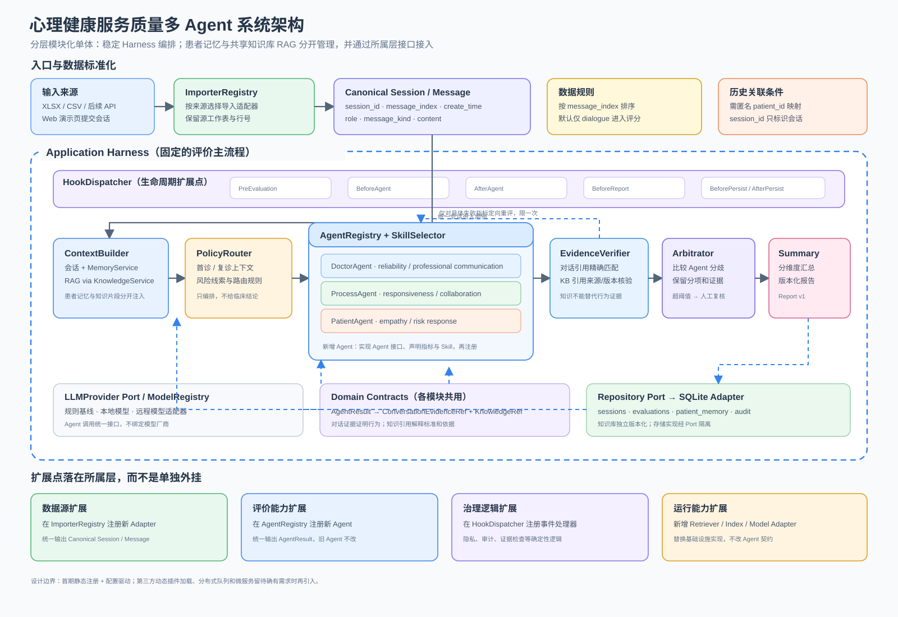
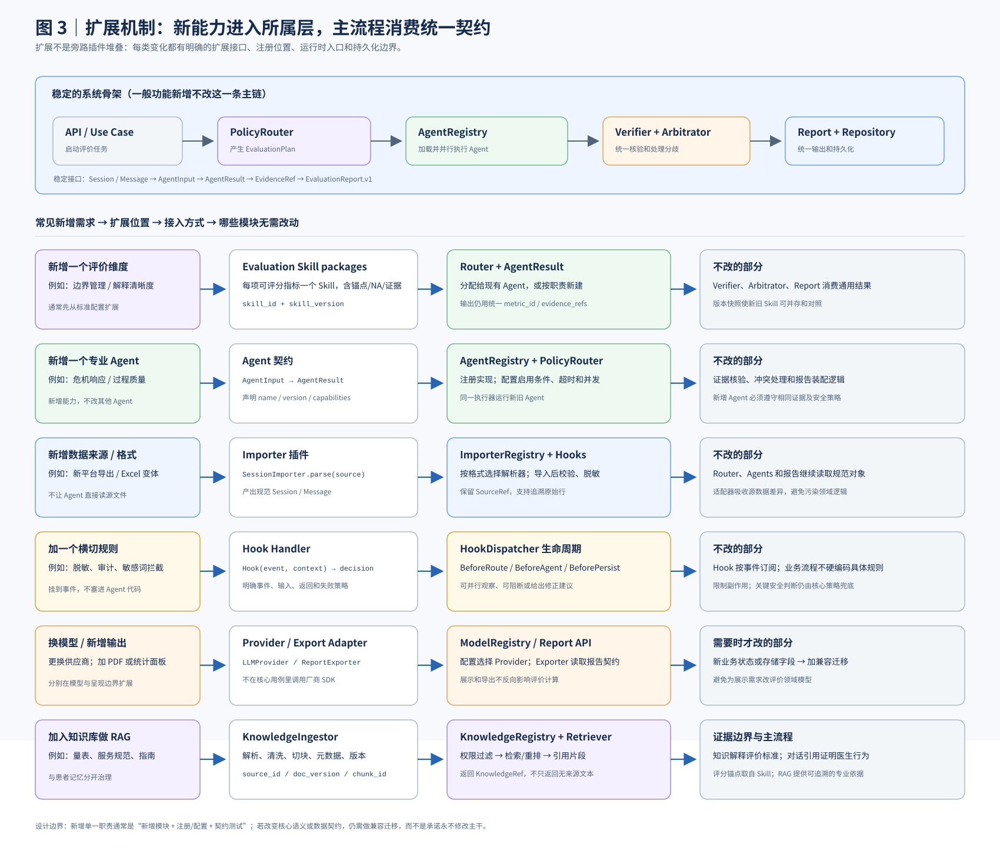
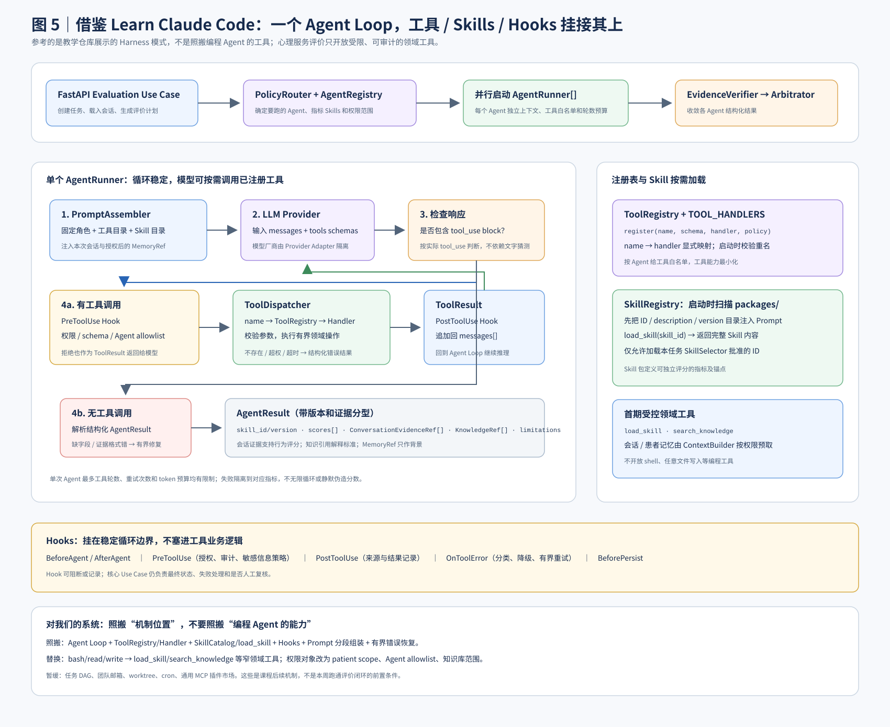
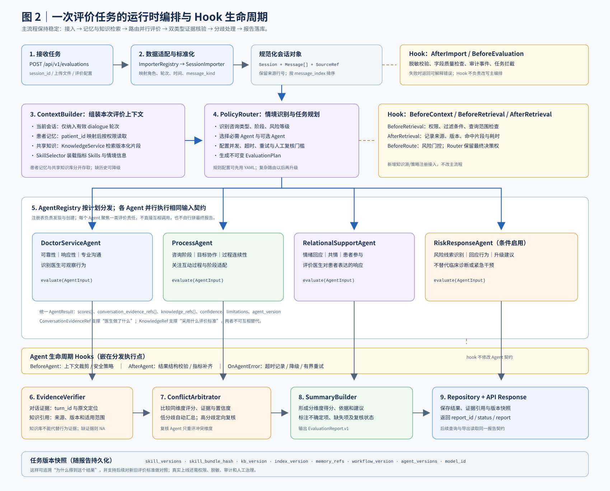
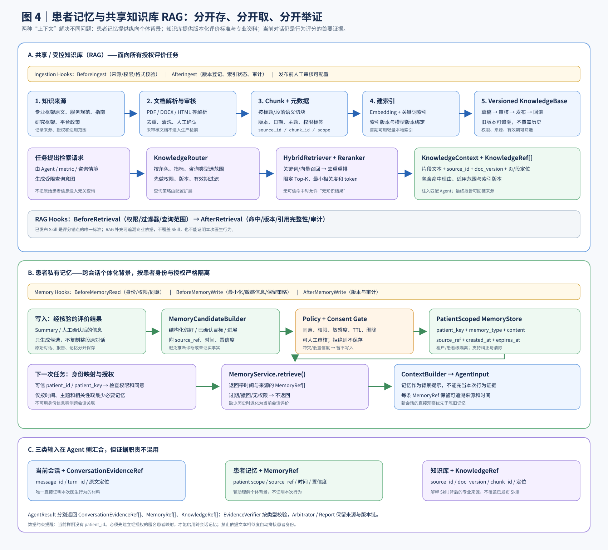

# 整体代码架构说明

> **文档状态：架构提案，待按此实施。** 当前仓库交付的是设计、目录约定和流程图，不代表下述 API、Agent、数据库或 RAG 已经编码完成。目标是三人团队在一周内做出可在评委电脑本地运行的演示版本，同时把扩展点提前隔离，避免新增指标、Agent、工具或知识源时大范围重构。

## 1. 目标与边界

系统面向在线心理咨询文本会话，对医生服务行为做多维、过程化、可追溯的辅助评价。流程从会话导入开始，经过情境识别、指标 Skill 选择、多 Agent 并行评价、证据核验和分歧仲裁，最终产出结构化报告。

一周 MVP 采用**模块化单体**而非微服务：一个 FastAPI 应用、清晰的 Python 包边界、SQLite 本地数据库和可替换的模型/检索适配器。模块化单体可本地一键启动，也保留以后拆服务的契约边界。

| 本周必须跑通 | 可先用模拟/桩实现 | 后续扩展，不阻塞 MVP |
|---|---|---|
| 导入脱敏会话；字段规范化；创建评价任务；返回结构化结果 | 无外部模型密钥时使用固定/规则化模型响应；RAG 使用小型示例知识集；异步并行可先用 `asyncio` | 生产级任务队列、复杂多轮工作流、独立服务拆分 |
| 指标以 Skill 文件注册、选择和加载；至少有一组演示指标 | 跨会话 Memory 默认关闭；评委数据使用合成或已脱敏样本 | 有可靠匿名患者映射、授权和治理后再启用跨会话 Memory |
| 专业/过程/共情等 Agent 输出带会话证据的结构化评价；核验、仲裁与报告可运行 | 向量检索可以由本地关键词检索适配器代替，保持检索接口不变 | MCP、插件市场、在线更新 Skill、分布式向量库 |

## 2. 系统架构图







参考 `learn-claude-code` 的是可借鉴的 Harness 机制（Agent Loop、工具注册/分发、Skills 按需加载、Hooks、权限控制等），不是照搬其单文件教学实现，也不是将其描述为 Anthropic 官方 Claude Code 源码。业务域、评价口径、隐私策略和数据模型均由本项目定义。

## 3. 一次评价的运行时流程



1. **导入与规范化**：Excel/CSV 由 `ImporterRegistry` 按格式/来源选择导入器，转成统一的 `ConversationSession`、`Message`；保留原始行号/消息 ID 作为追溯定位信息，不把原始文件交给 Agent。
2. **创建任务与上下文**：API 调用 `EvaluationUseCase`。`ContextBuilder` 组装当前会话、必要的情境信息、获准的 Skill 清单，以及权限允许的知识/记忆引用。
3. **策略路由与 Skill 选择**：`PolicyRouter` 判断适用任务与 Agent 组合；`SkillSelector` 根据任务和上下文从已注册 Skill 中选择允许使用的指标。路由规则先以可测试的显式规则实现，不让模型自行决定权限。
4. **多 Agent 评价**：`EvaluationCoordinator` 按 Agent Registry 获取参与者，并行调用各 `AgentRunner`。各 Agent 使用相同的受控循环和契约，但有各自的系统提示、允许指标、工具白名单和输出 schema。
5. **受控工具循环**：Agent 返回结构化结果，或提出工具调用。每次调用经过 `PreToolUse` Hook 与 `PolicyEngine`；`ToolDispatcher` 仅把已注册且在该 Agent 白名单内的工具派发给对应 Handler；随后执行 `PostToolUse` Hook，将结果作为 tool result 返回给模型。循环有最大轮次、超时和 token 上限；MVP 禁止 shell、任意网络访问和文件写入工具。
6. **证据核验与仲裁**：`EvidenceVerifier` 验证证据 ID 是否存在、引用片段是否对应当前会话、评价结论是否有证据支撑。`Arbitrator` 只处理预设的冲突类型：比较证据和指标锚点，给出采纳/降级/不确定结论；证据不足时不得编造折中分数。
7. **报告与持久化**：`ReportBuilder` 生成总体结论、分维度评分、证据、置信/不确定说明和改进建议；保存报告及 Skill/提示词/模型配置版本快照，API 返回 `evaluation_id` 与报告。

## 4. 推荐项目目录

目录是目标结构，实施时可以按依赖和功能分批建立；不是要求第一天创建空壳。

```text
.
├── app/
│   ├── main.py                       # FastAPI 启动与 lifespan 装配
│   ├── api/v1/                       # 路由、请求/响应 DTO、错误映射
│   ├── core/                         # 配置、日志、异常、依赖注入装配
│   ├── domain/
│   │   ├── models/                   # Session、Message、Evaluation、Report
│   │   ├── contracts/                # AgentInput/Result、Tool、Skill、Evidence
│   │   └── policies/                 # 评分/权限/数据边界的领域规则
│   ├── application/
│   │   ├── use_cases/                # ImportSession、EvaluateSession、GetReport
│   │   ├── orchestration/            # Coordinator、PolicyRouter、AgentRegistry
│   │   ├── context/                  # ContextBuilder、上下文裁剪与引用注入
│   │   └── hooks/                    # HookRegistry、事件与生命周期
│   ├── agents/
│   │   ├── base.py                   # Agent 声明与统一 AgentRunner
│   │   ├── professional/             # 专业沟通/咨询协作等评价 Agent
│   │   ├── process/                  # 服务过程/响应等评价 Agent
│   │   └── empathy/                  # 共情/情绪支持等评价 Agent
│   ├── tools/
│   │   ├── specs.py                  # 工具名、描述、参数 schema
│   │   ├── registry.py               # register_tool / 查找与冲突检查
│   │   ├── dispatcher.py             # 权限校验后按名称分发
│   │   ├── builtin.py                # 内置工具集中注册入口
│   │   └── handlers/                 # load_skill、search_knowledge 等 Handler
│   ├── skills/
│   │   ├── registry.py               # 启动时扫描 Skill 元数据
│   │   ├── selector.py               # 按任务/权限选择 Skill
│   │   ├── loader.py                 # 校验并按需读取 Skill 内容
│   │   └── packages/                  # 每项独立评价指标一个子目录
│   ├── evaluation/
│   │   ├── evidence_verifier.py
│   │   ├── arbitrator.py
│   │   └── report_builder.py
│   ├── knowledge/
│   │   ├── ingestion.py               # 文档登记、清洗、切块与版本
│   │   ├── retrieval.py               # 检索接口与本地实现
│   │   └── service.py
│   ├── memory/                        # 患者记忆策略、服务、存储接口
│   └── infrastructure/
│       ├── database/                  # SQLite models/repositories/migrations
│       ├── importers/                 # Excel/CSV 导入器及注册
│       ├── llm/                       # 模型 Provider 适配器
│       └── search/                    # 向量/关键词检索适配器
├── data/
│   ├── sample/                       # 仅合成或确认可公开的演示数据
│   └── knowledge_sources/            # 可分发的演示知识资料
├── tests/                            # unit / integration / fixtures
├── docs/architecture/               # 本说明及架构图
├── .env.example
├── .gitignore
├── pyproject.toml
└── README.md
```

### 4.1 依赖方向

`api → application → domain`；`application` 通过接口调用 `infrastructure`。`agents` 依赖领域契约与 application 提供的上下文/工具接口，不直接读数据库或私有文件。`tools/handlers` 调用 `knowledge`/`skills` 等应用服务，不绕过注册和策略。`domain` 不依赖 FastAPI、具体 LLM SDK、SQLite 或向量数据库。

## 5. 核心扩展契约

### 5.1 Agent 与结果

新增 Agent 只需实现统一 Agent 接口并注册，不改 Coordinator 的主循环。Agent 配置包含 `agent_id`、用途、允许的 Skill ID、允许的 Tool 名称、输入/输出 schema 和并行/超时策略。

建议 `AgentResult` 至少包含：

- `agent_id`、`status`、`skill_id`/`skill_version`、结构化 `findings` 与分数/等级；
- `ConversationEvidenceRef[]`：会话 ID、消息 ID 或起止消息、引用片段/定位，不仅是无法回溯的自然语言总结；
- `KnowledgeRef[]`、`MemoryRef[]`：分别标明知识来源和记忆来源，不混作对话证据；
- `limitations`、`confidence`、`error`：显式表示证据不足、缺失上下文、超时或失败。

`EvaluationCoordinator` 消费 Agent Registry，而不是硬编码逐个 Agent；新增评价维度时尽量只增加 Skill，只有确实需要新专业任务/输出责任时才增加 Agent。

### 5.2 Tools：注册、处理器与分发

工具由 `ToolSpec` 描述名称、用途和参数 JSON Schema；应用启动时经 `register_tool(spec, handler)` 加入 `ToolRegistry`。同名冲突启动失败，避免静默覆盖。Registry 保存 schema/元数据，Handler 实现实际动作，Dispatcher 负责参数校验、Agent 白名单、权限策略、调用、错误封装和 Hook。

MVP 预计只开放少量只读工具，例如 `load_skill`、`search_knowledge`。数据库读取、Memory 读取由经过授权的应用服务在 ContextBuilder 中完成；不为了模仿通用代码助手而开放任意工具能力。

### 5.3 Skills：评价指标体系的载体

**每个独立可评分指标对应一个 Skill**。指标的定义、观察要点、评分锚点、正反例、最低证据要求和不适用条件属于 Skill 内容；机器可读的稳定字段放在元数据文件里，避免把指标散落在 Python 条件分支中。

示例目录：

```text
app/skills/packages/
└── empathic_response/
    ├── SKILL.md       # 面向 Agent 的评价说明/操作步骤
    ├── metric.yaml    # id、version、维度、评分范围、输出 schema、适用条件
    └── examples.yaml  # 合成示例及其证据/评分
```

`SkillRegistry` 在启动时扫描并校验 ID 唯一性、必填元数据与版本；提示词只注入 Skill 名称/简介目录。运行时 `SkillSelector` 选出任务需要且获准的 Skill，Agent 通过 `load_skill` 按需取得完整内容。加载 Skill 不是执行代码；Skill 不可绕过工具权限、隐私策略或证据校验。每份评价报告保存实际使用的 Skill 版本，便于复现。

### 5.4 Hooks：统一生命周期插槽

`HookRegistry` 允许各模块注册回调，Hook 只监听/校验/记录生命周期，不承担核心业务分支。建议事件包括：`EvaluationStarted`、`ContextBuilt`、`PreToolUse`、`PostToolUse`、`AgentCompleted`、`EvidenceVerified`、`EvaluationCompleted`、`EvaluationFailed`。权限判断必须由确定性的 `PolicyEngine` 执行，不能只依赖 Hook 回调或模型判断。Hook 异常按事件策略记录并安全失败；不得因日志插件故障而放行受限动作。

### 5.5 动态路由

`PolicyRouter` 根据会话是否完整、咨询阶段/主题等已定义特征，挑选 Agent 和候选 Skill。第一版优先做**可解释、确定性路由**，路由结果写入任务 trace。后续可添加模型辅助分类器，但模型建议须经过规则约束与权限过滤；路由器不直接构造任意 Python import 或执行未注册模块。

## 6. RAG 与 Memory 的数据边界



### RAG（专业知识库）

入库流程：来源登记与授权 → 文档审核/脱敏 → 清洗切块 → 附来源、标题、版本、页码/段落等元数据 → 索引 → 带权限过滤检索 → 返回 `KnowledgeRef`。一周版本可以先做本地小知识集与关键词检索；通过稳定的 `KnowledgeRetriever` 接口替换为向量检索。检索内容用于解释标准或辅助理解，**不能改写 Skill 评分锚点**；报告需要保留知识引用及版本。

### 患者 Memory（跨会话背景）

Memory 与知识库不是同一类数据：它是患者相关的敏感背景，只能在合法授权和正确患者关联后使用。必须有匿名患者键、用途限制、访问控制、删除/过期策略和审计记录；上下文需标注 `MemoryRef` 及来源/时间。Memory 是背景信息，不是医生行为证据；医生服务评分必须引用本次会话中的可观察行为。

已知样例表格中缺少 `patient_id`。在数据治理方提供可信的匿名映射及授权前，**不做跨会话拼接，不以姓名、文本相似度或模型推测患者身份**；先按单次会话评价。演示和仓库中只使用合成/确认可分享的数据。

## 7. API、存储与可观测性

建议 MVP 路由：

| 方法与路径 | 用途 |
|---|---|
| `GET /health` | 本地健康检查 |
| `POST /api/v1/sessions/import` | 上传脱敏 Excel/CSV 并返回导入结果/会话 ID |
| `POST /api/v1/evaluations` | 为会话创建评价任务，可选 Skill/Agent 配置 |
| `GET /api/v1/evaluations/{id}` | 获取任务状态与阶段摘要 |
| `GET /api/v1/reports/{id}` | 获取结构化报告与证据引用 |

SQLite 最少保存 `sessions`、`messages`、`evaluations`、`agent_runs`、`reports`、`knowledge_documents` 等数据。敏感原始导入文件默认只留在受控本地目录或导入后删除；数据库不作为可提交文件。日志使用任务 ID 和会话匿名 ID，默认不记录完整对话正文、API Key 或未经脱敏的上下文。报告记录 schema 版本、Skill 版本和配置快照。

## 8. 三人协同开发与 GitHub 流程

先在第 1 天共同冻结 `domain/contracts`、目录骨架、最小端到端用例和 API/结果 schema；契约变更通过 PR 协商，避免三人各自定义不同的 Agent/Skill/数据格式。

| 负责人 | 主责模块 | 可并行交付 |
|---|---|---|
| A：平台与运行时 | FastAPI、导入入口/任务 API、Coordinator、AgentRunner、Tool Registry/Dispatcher、Hooks、集成装配 | 用 Mock Agent 跑通一次端到端任务和接口 |
| B：评价方法 | 各指标 Skill 包、Agent 提示与 schema、证据核验、分歧仲裁、报告结构 | 用固定会话样例验证评分锚点和证据引用 |
| C：数据与知识 | Excel/CSV 标准化导入、SQLite repository、知识库入库/检索、Memory 策略边界 | 提供固定 fixture 与 `KnowledgeRetriever` 本地实现 |

GitHub 协作约定：`main` 保持可运行；每人使用短期功能分支；小步提交并发 PR；至少一人 review 后合并；CI 跑格式检查、单元测试和端到端 smoke test。不要直接向 `main` 推未验证的大改动。`.env`、患者原始数据、SQLite 文件、向量索引和日志均不入库；`.gitignore` 只是保护措施之一，PR 前还要检查 `git status` 和差异内容。

## 9. 一周实施顺序与验收

| 时间 | 可验收里程碑 |
|---|---|
| 第 1 天 | 初始化骨架；冻结 Session/Message/AgentInput/AgentResult/Report 契约；三人分工；选定一个脱敏或合成样例 |
| 第 2 天 | 导入与 SQLite 可用；Skill Registry/Loader、Tool Registry/Dispatcher、基础 Agent Loop 可单测 |
| 第 3 天 | 至少三个职责清晰的 Agent/多项指标 Skill；Agent 并行运行；结果带证据引用 |
| 第 4 天 | EvidenceVerifier、Arbitrator、ReportBuilder 串通；最小 RAG 可返回带来源知识引用 |
| 第 5 天 | FastAPI 端到端 API 完成；异常、超时、无证据与部分 Agent 失败有明确状态 |
| 第 6 天 | 补单元/集成/smoke tests；README 启动说明；准备合成演示数据；在干净环境验证 |
| 第 7 天 | 评委电脑本地启动演练；记录模型配置/无 Key 的演示模式；修复阻塞问题，冻结版本 |

交付验收不以“用了多少 Agent”衡量，而以评委能否完成**导入一个脱敏样例 → 发起评价 → 查看分维度报告 → 点回会话证据/知识引用 → 理解不确定结论**为准。若模型服务 Key、网络或硬件不可用，应保留可复现的模拟演示路径，不把模拟结果伪装成真实模型评估。

## 10. 参考架构学习边界

本设计吸收 `learn-claude-code` 教学项目体现的机制：工具描述与 handler 分离、运行时注册与分发、有限 Agent Loop、Hooks、权限检查、启动时发现 Skill 并按需加载。我们只借鉴机制，不复制其代码组织或把通用代码代理能力照搬到心理健康场景。项目必须额外落实患者数据最小化、证据溯源、指标版本化、人工可审阅和高风险结论审慎表达。
