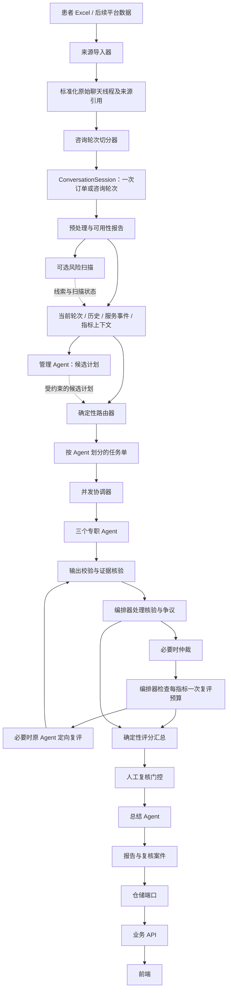

# 三人协作开发与模块接口约定

更新日期：2026-10-11。

本文件对照实际 Excel 数据、项目指标表和当前 Python 骨架，确定三人分工前需要统一的模块边界。重点是可独立开发、可替换实现和小范围扩展，不评价模型效果。

结论：现有模块化单体、组合根、三个专职 Agent 和确定性编排方向可以保留；当前代码尚未具备全部可独立对接的接口。目录已分层，但导入与咨询轮次切分、逐 Agent 任务单、核验/仲裁/总结交接对象及业务 API 仍需补齐。本文件中的新增类型和接口是待实现约定，不表示已存在于代码。

## 1. 已确认的业务边界

1. 一份质检报告评价一次订单或咨询轮次，不直接评价跨数年的整个聊天线程。长聊天记录必须先切分。
2. 完整初评默认包含 D1–D6 的 18 项指标任务。D6.1、D6.2 各自判断适用性；不适用或上下文不足返回空分数及原因。
3. 风险 Hook 仅提供可选候选线索。命中、未命中、未配置和失败都不能决定是否分配 D6。Hook 的状态也不能直接代替指标适用性判断。
4. 每项指标有唯一评价主体。专业服务 Agent 负责 D1/D3/D6.2，过程与响应 Agent 负责 D2/D5，共情与关系 Agent 负责 D4/D6.1。
5. 保留管理与情境识别、证据核验、仲裁、总结的既有角色设计。管理 Agent 给出候选计划，不能移除默认必查指标；最终任务指派、流程和重评次数由代码控制。
6. 定向复评只包含指定争议指标，不因为完整初评默认包含 18 项而重复执行全部指标。

## 2. 实际数据与指标表核对

### 2.1 数据结构

数据来源：项目上级目录 `数据/patients`，含 49 个 XLSX 文件及 `_index.csv`。索引有 972 条记录，其中 950 条记录的会话数为 1，22 条大于 1；969 条记录的最早与最晚消息不在同一天。索引中 208 个“患者ID”以 `session_` 开头，不能仅凭列名或该前缀确认真实患者身份关联。

抽查 `patients_001.xlsx`、`patients_025.xlsx`、`patients_049.xlsx` 的全部 52 张工作表、42,911 行消息，均为以下六列：

```text
chat_session_id, message_index, create_time, role, message_kind, content
```

抽查消息类型为 dialogue 28,558 行、non_dialogue 784 行、system_notification 13,569 行。系统通知也使用 doctor/patient 角色；存在 1,313 条内容为 `[图片]` 的占位消息。这些数量是三个文件的抽样结果，不代表全部 49 个文件的完整统计。

架构必须保留：

- `role` 与 `message_kind` 两个独立字段。不能把 `role=doctor` 的系统通知当成医生实际回应；系统通知也不能全部删除，其中可能包含服务事件线索。
- 原始聊天线程 ID 与内部咨询轮次 ID。一个线程可以对应多个轮次，患者分组也可能包含多个线程。
- 文件、sheet、原始行号、原始消息序号及来源命名空间，以便回查和稳定生成消息 ID。
- 内容可用状态。`[图片]` 是缺失媒体内容的占位，不能当成普通文本或声称已实现图片分析。
- 可缺失的订单 ID、医生标识、咨询开始事件、患者可信关联信息。抽查六列中未提供这些独立字段。

### 2.2 指标原表

来源：项目上级目录 `人工智能+心理医生服务质量评估-竞赛-261010-qwx.docx`。原表定义 6 个维度、18 项指标，分布与现有设计一致。原表编号为 `1.1` 等，下列内部 ID 统一加 `D` 前缀，中文名称保持原表。

- 专业服务 Agent：D1.1 实质性服务履行；D1.2 服务内容一致性；D3.1 症状信息探询；D3.2 病史与治疗信息核对；D3.3 心理社会背景探询；D3.4 关键诉求回应；D3.5 信息解释清晰性；D6.2 必要转介与求助提示。
- 过程与响应 Agent：D2.1 首次响应及时性；D2.2 交互响应及时性；D5.1 咨询目标协商；D5.2 患者意见征询；D5.3 建议个体化程度；D5.4 建议可执行性。
- 共情与关系 Agent：D4.1 情绪识别与回应；D4.2 反映式理解；D4.3 尊重与非评判性；D6.1 风险信号回应。

必须在输入契约上体现的要求：

1. D2.1 的起点是“订单进入咨询阶段”，终点是“医生首次实际回复”。不能以线程第一条消息自动代替咨询开始事件。
2. D2.2 针对需要回应的问题与随后医生回复，需要保留轮次和消息角色/类型。时间差由确定性工具计算，语义模块可以识别应答配对。
3. 原表还引用 `service_order`、`Advisory`、`patient` 等来源。当前抽查 Excel 没有这些独立结构化表；不能假设六列已经覆盖所有输入需求。
4. 原表未给出 0–5 分量表、权重和覆盖率门槛。它们属于待配置的评分策略，不应被当成原表已规定的内容。

## 3. 目标模块连接方式



这是有类型边界的固定工作流。扩展点是导入器、切分器、Agent、Skill、Provider、工具和仓储适配器；暂不把整个流程改造成任意插件自动拼装的引擎。

## 4. 当前已经可保留的模块边界

- `EvaluationAgent.evaluate(AgentInput) -> AgentResult`：三个专职 Agent 的统一异步接口。
- `AgentRegistry`：通过显式注册替换实现，无需修改协调器的执行算法。
- `PreprocessingPipeline` 与阶段对象：新增或替换预处理阶段由组合根装配。
- `SessionRepository`：领域会话与存储实现分开。
- `KnowledgeRetriever`、转写/脱敏端口：外部能力可替换。
- `bootstrap.py`：集中装配。新增适配器需要改一处注册配置是正常的，不属于大改架构。
- `EvaluateSessionUseCase` 与 `EvaluationCoordinator`：前者控制业务阶段，后者仅执行并发、超时和错误隔离。

## 5. 分工前应补齐的接口

### 5.1 导入与咨询轮次切分

当前 `ConversationImporter.import_file` 直接返回 `ConversationSession`，默认跳过了原始线程与评价轮次的区别。建议新增 `SourceConversation` 和 `SessionSegmenter`；已有标准化会话导入器可保留，通过适配层复用。

```text
SourceImporter.read(source) -> ImportResult[SourceConversation]
SessionSegmenter.segment(SourceConversation, SegmentationPolicy) -> SegmentationResult
SegmentationResult.sessions -> list[ConversationSession]
```

关键字段约定：

- `ConversationSession.session_id`：内部一次订单/咨询轮次的稳定 ID。
- `source_conversation_id`：原始 `chat_session_id`；不能直接等同于上面的内部 ID。
- `order_ref`、`service_started_at`、`ended_at`：可缺失，不能制造值。
- `segmentation_version`、`boundary_source`、`boundary_status`：切分依据、版本和边界是否明确。
- `Message.message_kind`：dialogue / system_notification / non_dialogue / unknown；保留原始角色，不用更改角色来掩盖消息类型。
- `Message.source_ref`：来源命名空间、文件/sheet/行号、原始消息序号。消息 ID 根据稳定来源键生成，不能仅使用 `message_index`。
- `Message.content_status`：available / placeholder / unavailable；媒体能力后续独立接入。

已确认按订单或咨询轮次评价，但具体切分规则仍待配置。优先使用明确订单和服务开始/结束事件；如使用时间间隔启发式，必须有独立策略版本并标记边界推定，不能将其伪装成真实订单。仅靠时间间隔不能凭空恢复缺失的订单开始时间。无法切分时返回限制/待处理状态，不将整段多年线程自动当成一次咨询。

建议落点：来源解析在 `infrastructure/importers/`；切分策略端口在 `application/segmentation/`；通用对象在 `domain/`。其他模块不读取 Excel 列名。

### 5.2 服务事件与历史上下文

新增显式 `ServiceContext`，包含订单/服务事件引用、咨询起止时间及字段可用状态；按需扩展 Advisory/患者背景的只读来源片段。它与知识库、历史会话分开，避免把平台事实放进自由文本规范。

证据契约应允许两类当前轮次事实：`ConversationEvidenceRef` 与 `ServiceEventRef`。D2.1 时间计算引用服务开始事件和实际回复消息；规范知识仍是 `KnowledgeRef`，不能替代事实证据。

历史检索端口建议：

```text
HistoryRetriever.retrieve(HistoryRequest) -> HistoryContext
```

`HistoryRequest` 至少包含可信患者引用、当前轮次 ID、时间截止点、访问范围和数量上限。历史可以来自同一聊天线程的较早轮次；不能因为线程 ID 相同就与当前轮次混在一起，也不能包含当前轮次之后的消息。无可信身份关联时返回明确状态，不能根据 sheet 名猜测患者身份。初诊/复诊来自可信信息，数据中首次出现不自动等于初诊。

### 5.3 指标目录与逐 Agent 任务单

当前 `RoutePlan` 只有全局 `agent_ids/skill_ids`，协调器给所有 Agent 同一个 `AgentInput`；`EvaluateSessionUseCase` 也没有传递 `plan.skill_ids`。这不足以支撑分工后的指标归属和定向复评。

建议保留外部 `evaluate` 接口，扩展内部输入并增加任务对象：

```text
MetricDefinition:
  metric_id, dimension_id, source_number, name, version, status
  owner_agent_id, skill_id, required_inputs, applicability_rule
  score_scale, anchors, weight, evidence_policy

AgentTask:
  task_id, run_id, evaluation_id, agent_id
  metric_ids, skill_versions, attempt, previous_finding_refs
  input: AgentInput

RoutePlan.tasks -> list[AgentTask]
EvaluationCoordinator.run(tasks) -> list[AgentResult]
```

完整初评由已发布指标目录产生 18 项任务，按 8/6/4 项分给三个专职 Agent。管理 Agent 不能将 D6 或其他必查指标删除；适用性由指标结果表达。复评仅创建争议指标任务，`attempt=1`。

`AgentInput` 需明确本次 `metric_ids`、Skill 定义/版本、预处理限制、当前轮次、服务事件、历史和可选风险扫描结果。每个 Agent 接收独立输入对象，不通过修改共享可变对象与其他 Agent 通信。

### 5.4 Provider 与共享 AgentRunner

当前 `LLMProvider.complete(system_prompt, user_prompt) -> str` 和 `AgentRunner.run(AgentInput)` 尚不能表达不同 Agent 的配置、结构化输出及运行元信息。建议在三人实现具体 Agent 前统一：

```text
AgentRunner.run(AgentDefinition, AgentInput) -> AgentResult
LLMProvider.complete(LLMRequest) -> LLMResponse
```

`AgentDefinition` 保存 Agent ID、提示模板版本、输出契约和工具白名单。`LLMRequest` 保存消息、输出 Schema、工具定义（如启用）及调用参数；`LLMResponse` 保存内容、工具调用、模型和用量。Runner 负责统一解析、校验、工具轮次与调用限制，具体 Agent 只负责职责配置。

可保留现有 Provider 的适配桥接，避免直接将某供应商 SDK 类型暴露给 Agent、编排器或前端。

### 5.5 核验、仲裁、总结和评分交接

当前 `Finding` 没有稳定 finding ID，核验只返回字符串列表；仲裁输入不包含结构化核验意见及明确的初评/复评关系；总结接口只返回改进意见，无法返回文档要求的报告叙述。需要统一以下对象：

```text
Finding: finding_id, metric_id, metric_version, attempt, supersedes_finding_id, ...
FactClaim: claim_id, finding_id, claim_type, statement, subject_role,
  behavior, object_text, time_scope, negated, qualifiers
ClaimVerification: claim_id, supported | contradicted | insufficient_evidence, evidence, counter_evidence, rationale
EvidenceVerificationResult: finding_id, reference_status, claims, claim_results,
  reference_conflict, applicability_status, rubric_status, support_status,
  issues, revision_request, verifier_version
ArbitrationContext: conflicts, original_findings, revised_findings, verification_results, rules
SummaryResult: narrative, score_explanation, improvements, limitations, status
ScoreAggregator.aggregate(validated_metrics, rubric_snapshot) -> QualityProfile
ReviewGate.evaluate(ReviewContext) -> ReviewGateDecision
```

`FactClaim`、`ClaimVerification`、`EvidenceVerificationResult` 及 Finding 的版本关系已加入领域模型，其余仍为待实现接口。`ReviewContext` 用具名类型承载风险、核验、冲突、覆盖率和执行状态，不以无类型 `list` 和任意 `None` 传递。评分器输入应包含完整预期指标集合及各项状态，否则遗漏指标可能从覆盖率分母中消失。

原始初评、核验质疑、评价 Agent 回复、修订版和仲裁结果分别保留；最终采纳结果通过引用表达。证据核验 Agent 不与评价 Agent 各打一个分，编排器只允许一次有明确问题的质疑—修正；接受修正则再次核验，仍有分歧才仲裁。分数上限、权重、适用条件来自版本化配置，避免后续改量表时同时修改多个 Pydantic 模型中的硬编码范围。

### 5.6 Hook 与核心策略的区分

现有 `HookRegistry` 回调返回 `None`，错误被隔离，适合审计通知等旁路扩展。不要依靠回调偷偷修改共享字典来输出风险结果，也不要将强制预处理和权限校验放入可忽略失败的事件回调。

风险扫描保留 Hook 的产品叫法，但内部通过有类型端口返回：

```text
RiskScanner.scan(session) -> RiskScanResult
RiskScanResult: status(completed / failed / not_configured), candidates, issues, version
```

扫描结果只能补充上下文，D6 默认任务不读取它来决定是否存在。空 candidates 与扫描失败分别表达。

### 5.7 存储、运行与前端接口

除现有会话仓储外，补齐任务、运行、报告、复核案件和决定的仓储端口。内存版和持久化版必须满足同一套契约测试。

一次报告应保留 `evaluation_id`、`run_id`、当前轮次快照、切分版本、指标快照、各 Agent 运行引用、核验/仲裁/复评结果和复核状态。重新执行创建新运行；人工更正不覆盖原始 Finding。

API 响应单独定义 DTO，前端不直接依赖内部 `AgentInput` 或未来可能拆分的领域对象。先确定创建任务、查询进度、读取报告、读取轮次消息、提交复核决定的请求/响应及错误格式；提供合成 fixture 或 Mock 服务，前端不等待真实 LLM 才开始开发。

## 6. 建议三人分工

下面是职责建议，可按成员专长调整；不是要求每人分别维护一套独立 Agent 框架。

### A：数据与应用后端

负责数据导入、咨询轮次切分、预处理、服务事件/历史检索、仓储、任务生命周期、API 及组合根集成。向 B 提供统一的可评价轮次与上下文，向 C 提供版本化 API。A 同时担任集成负责人。

主要目录：`application/`、`infrastructure/importers/`、`infrastructure/repositories/`、`api/`、`bootstrap.py`。

### B：Agent 与评价引擎

负责共享 Provider/Runner、三个专职 Agent、管理/核验/仲裁/总结实现、指标 Skill、确定性评分和门控。输入输出遵守公共契约，不直接读取 Excel、不写数据库、不调整 API 页面字段。

主要目录：`agents/`、`skills/`、`evaluation/`、`tools/`、`infrastructure/llm/`。

### C：前端与联调场景

负责前端工程、任务页、报告与证据定位、复核工作台，以及基于 API fixture 的交互。按 DTO 展示指标列表，不将 18 项指标和分数计算重复写死在页面里。

主要目录：`frontend/`；参与 API 契约与合成联调样例评审。

如果三人实际均负责后端，也应先共同完成 Runner/Provider，之后再按三个专职 Agent 的实现与 Skill 包分工，不能每人重写自己的模型调用、核验、评分或数据库逻辑。

### 公共文件协作规则

- `domain/`、API DTO 和契约 fixtures 先共同确认，由集成负责人合入变更，避免三人同时随意改字段。
- 具体实现模块只导入公共契约，不跨模块导入另一位成员的具体实现。
- `bootstrap.py` 由集成负责人维护；注册新实现只需添加 import/注册配置。
- 新增可选字段尽量保持兼容；删字段、改字段含义或改变状态枚举，先更新契约与消费者，必要时提升 Schema 版本。
- 当前 `models.py` 可按 session/evaluation/report 等领域拆文件，但保留兼容导出，避免仅为目录整洁造成大量调用方改动。

## 7. 用变化场景验收“搭积木”

- 换 Excel 格式：只增加来源适配器和注册，Agent 输入与报告 API 不变。
- 调整咨询轮次切分：只改切分策略/版本；历史引用与报告仍按标准轮次对象工作。
- 接入订单表：增加服务事件适配器，填充已有 `ServiceContext`；不重写 D2 Agent 和页面。
- 更换模型供应方：只换 Provider 实现与配置，Agent 职责、评分和 API 不变。
- 添加同一输出体系下的新指标：新增 Skill/指标定义及归属配置，路由和前端从目录读取；不改协调器算法。
- 换评分权重或分数范围：修改版本化评分配置，原报告保留旧版本。
- 替换证据核验实现：仍返回相同 `VerificationResult`，仲裁、门控和前端无需同时重写。
- 内存改数据库：替换仓储实现与组合根，Agent 不变。
- 新增图片语义等新能力：需要扩展对应输入契约与适配器，这是合理的局部演进，不能承诺任何需求都零改动。

## 8. 分工启动前的交付门槛

以下是后续骨架实现的验收项目，本轮文档更新并未实现这些功能：

1. 合成输入可经过导入与切分，形成两个独立轮次；当前轮次与较早轮次背景不混用。
2. 系统通知即使源角色为 doctor，也不会被时间工具当成医生首次实际回复。
3. 完整任务从指标配置得到 18 个唯一指标、8/6/4 的归属；四种 Hook 状态下归属相同。
4. 三个 Fake Agent 可返回固定合法结果，运行经过核验、评分、门控、总结及报告存储；不需要真实模型密钥。
5. 一个指标复评后只增加该指标运行记录；核验和仲裁共用一次额度，不重跑其他指标。
6. 替换 Fake Provider/仓储后，用例和 API fixture 不需要改写。
7. 前端可用固定契约完成任务查询、证据定位和复核提交，错误/部分完成也有合成场景。

达到这些条件后，三人分别填充实现才能稳定地像搭积木一样协作。当前 32 项测试覆盖已有骨架行为，但尚未覆盖以上完整接口连接。

## 9. 本轮变更范围

已同步 README、架构文档、后台融合提案、PRD 和后端功能说明中的 D6 默认任务规则；对齐指标原表名称，并记录按订单/咨询轮次评价的决策。本轮未重构运行时代码、未导入或修改患者数据、未新增模型调用；风险 Hook 的运行实现原本就尚未接入，因此不存在已运行的 D6 条件分支需要删除。
