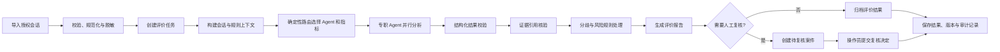

# 在线心理咨询服务质量监测 Agent 后端功能说明

| 属性 | 内容 |
| --- | --- |
| 产品 | 在线心理咨询平台医生服务质量监测 Agent |
| 使用对象 | 平台质检操作员（单账号、单工作空间） |
| 文档范围 | 后端 Agent、评价流程、数据接口与质检结果 |

## 1. 后端 Agent 的职责

后端 Agent 服务接收平台授权的咨询会话，按照可配置、可版本化的质检指标分析医生在对话中可观察到的服务行为，返回有消息证据支撑的评价结果，并将高风险或证据不足的结果送入人工复核流程。

它承担的是大规模初筛、指标化评价、证据定位和结果整理工作。它不诊断患者，不替代心理咨询专业判断，不根据一次文本对话推断医生的全部临床能力，也不自动处罚医生或联系患者。

## 2. 端到端工作流程

## 3. 数据接入与预处理

### 3.1 输入内容

单次评价的输入包括：

- 会话 ID 和按时间或顺序排列的消息；
- 每条消息的 ID、发言方（医生、咨询者、系统或未知）、内容和顺序号；
- 可用时提供消息时间、数据来源和必要的会话元信息；
- 本次任务选用的指标/Skill 版本和平台质检规则。

### 3.2 预处理职责

- 校验会话结构、必填字段、消息顺序和发言方标记；
- 把来源数据转换为统一的会话与消息结构；
- 检查空会话、重复消息、字段缺失和异常长度，并将问题反馈给操作员；
- 在进入模型上下文前移除或替换不参与评价的姓名、手机号、账号等直接身份信息；
- 保留匿名消息 ID，使后续结论可以跳转到原会话中的对应证据；
- 将原始对话证据、平台规则知识和患者背景记忆分别管理，不互相冒充来源。

会话内容只用于获准的质检任务。跨会话患者记忆默认关闭；外部模型调用需服从平台的数据授权与服务配置。

## 4. 评价任务与 Agent 编排

### 4.1 评价任务

任务记录评价范围、所用指标版本、创建时间、运行状态和每个 Agent 的运行结果。任务状态包括排队中、运行中、已完成、部分完成和失败。操作员可以查看进度、报告和失败原因；重试创建新的运行记录，不覆盖原始结果。

### 4.2 确定性路由

路由器根据会话结构、任务选项、指标适用条件和已登记规则决定本次需要运行哪些 Agent 与 Skills。路由过程可解释并记录选择原因；空会话或不满足输入条件时停止评价并返回数据问题。路由器不执行模型生成，也不动态导入未经登记的 Agent 或工具。

### 4.3 Agent 协调

协调器调用路由选中的专职 Agent，可并行运行互不依赖的分析任务。每个 Agent 使用统一输入和结构化输出契约。一个 Agent 失败时保留其他 Agent 的有效结果，并把整份报告标为部分完成；全部 Agent 失败时任务标记为失败。

Agent 只调用登记过的工具。工具权限限于完成评价所需的 Skill 查询、规则检索和必要数据读取，不允许 Agent 自行执行未授权的数据写入、对外通知或平台处罚操作。

## 5. 专职评价能力

各评价器围绕稳定指标工作；新增评价标准通过 Skill/指标定义扩展，不以增加 Agent 数量作为产品目标。

### 5.1 共情回应评价

- 判断医生是否注意到咨询者明确表达的情绪或体验；
- 评价回应是否贴合表达、尊重感受并保持真诚；
- 识别忽视、否定、轻率安慰、机械套话等可观察沟通问题；
- 不能从未表达的信息推断咨询者的内在状态；
- 证据不足或情境不适用时返回不评分及原因。

### 5.2 专业沟通与服务边界评价

- 根据已审定的服务标准，评价表达是否清晰、尊重、审慎；
- 识别越界承诺、武断保证、明显不当言语或隐私处理问题；
- 检查医生对风险表达的回应是否符合平台发布的流程要求；
- 只评估对话中可观察的服务行为，不依据单段文本判定临床诊断或完整专业资质。

### 5.3 咨询过程评价

- 观察医生是否澄清咨询者提出的问题和当前需求；
- 评价追问是否与上下文相关，回应是否围绕需求推进；
- 识别是否有阶段性总结、下一步说明或适当的结束衔接；
- 对缺少上下文、截断会话或超出适用范围的指标明确说明限制。

### 5.4 风险信号识别

- 从对话上下文中发现平台规则定义的高优先级线索，例如明确的自伤/伤人表达、严重危机表述、隐私泄露或明显服务边界问题；
- 区分“咨询者表达的风险信号”和“医生对此作出的服务回应”；
- 为每个线索保留触发依据、关联消息、优先级建议和不确定性说明；
- 由策略规则决定是否进入人工复核队列，并由平台操作员确认后续处理。

风险信号是需要核查的运营线索，不是对咨询者的临床诊断。系统不向咨询者发送自动危机通知，也不代替平台的人工应急流程。

## 6. 质检指标与 Skills

每个指标 Skill 描述指标 ID、名称、版本、定义、适用条件、评分范围、评分锚点、必需证据要求和示例。平台可维护共情回应、专业沟通、咨询过程、风险响应等指标包。

评价时，Agent 按适用 Skill 逐项输出结论。需要分数的指标使用统一量表；只有在证据充分且适用时才给分。无法判断、不适用或会话信息不足时返回空分值和原因，不能把不确定结果压成低分。

每次运行保存所用 Skill/规则版本，确保同一报告可以解释其评价依据。新版本发布不改写旧任务已经使用的版本。

## 7. 结构化结果、证据与仲裁

### 7.1 评价结果

每个 Agent 以结构化结果返回：

- Agent 标识与执行状态（完成、部分完成、失败）；
- 指标 ID、适用性、分数或不评分状态；
- 简短结论和面向质检人员的理由；
- 会话证据引用、外部规则知识引用和限制说明；
- 风险线索、优先级建议和是否需要人工复核。

整体报告包含评价 ID、会话 ID、运行状态、各 Agent 原始结果、综合摘要、证据问题、未解决分歧和所用规则版本。报告不得隐去单个 Agent 失败或用统一分数掩盖分歧。

### 7.2 证据核验

- 检查被引用的消息 ID 是否属于本次会话；
- 检查引用片段是否能在对应消息原文中定位；
- 检查引用是否足以支撑相应指标结论，并区分会话证据与平台规范知识；
- 对无效、缺失或不足的证据标记问题，阻止其成为已确认结论并送人工复核。

核验通过仅说明引用可追溯，不等于结论必然正确。报告展示证据片段、消息发言方和会话顺序，便于操作员回到完整上下文复查。

### 7.3 分歧仲裁

当多个 Agent 对同一指标或风险线索意见不一致时，仲裁流程对照指标锚点、证据质量和各自理由生成可审阅的分歧说明。证据或规则无法支持唯一结论时保留“未解决”状态并进入人工复核，不采用简单平均分来消除分歧。

## 8. 风险案件与人工复核接口

符合平台复核规则的结果生成案件，记录来源会话、任务、风险类别、优先级建议、触发依据、证据引用、案件状态和创建时间。单账号模式下由平台质检操作员处理全部案件，不设计成员分派、认领或角色流转。

质检操作员可查看脱敏会话和 Agent 原始结论，并提交确认、驳回、修正、无法判断或升级处理等决定及理由。系统保留模型结果和人工结果的完整关联，记录提交时间与操作员；新的复核不会静默覆盖历史记录。

人工复核结果用于质量改进、指标校准和误报/漏报分析，不自动触发处罚。需要采取平台处置时，由平台现有流程和授权人员按政策另行决定。

## 9. 报告与运营数据

评价报告按会话展示各质检维度、证据、风险提示、运行状态、限制说明和指标版本；任务汇总提供会话数、完成/失败/部分完成数、各类风险案件数和复核状态统计。

统计数据需附时间范围与样本量。样本不足时说明不足原因；没有经专家标注的验证集和可靠统计设计时，不宣称模型准确率，不生成医生公开排名。

## 10. 后端接口职责

后端通过版本化 HTTP API 为单账号质检后台提供操作入口：

- `POST /api/v1/sessions/import`：导入会话并返回逐条校验结果；
- `POST /api/v1/evaluations`：按范围和指标版本创建评价任务；
- `GET /api/v1/evaluations/{evaluation_id}`：查询任务状态、进度和阶段结果；
- `GET /api/v1/reports/{report_id}`：读取结构化报告和证据定位信息；
- `GET /api/v1/review-cases`：按风险类别、级别、时间和状态查询复核案件；
- `POST /api/v1/review-cases/{case_id}/decision`：提交人工复核决定和理由；
- `GET /api/v1/dashboard/overview`：读取任务、质量维度和复核队列汇总；
- `GET /api/v1/audit-events`：查询会话访问、任务、导出和复核等操作记录。

未登录请求由后端拒绝。MVP 的服务端只验证一个操作员账号和一个工作空间，不接受客户端参数改变数据范围。前端不自行计算模型分数或风险等级。

## 11. 失败处理与安全边界

- 输入无效：返回字段级错误和数据行定位，不生成评价结论；
- 会话为空或被截断：标记不可评价或部分可评价，列出限制；
- 单 Agent 超时或异常：保留其他 Agent 结果，标记部分完成并说明失败模块；
- 输出不符合数据结构：进行有限次数的格式修复；仍失败则记录错误并转人工检查；
- 证据引用无效：对应结论不通过证据门槛，创建复核线索；
- 多 Agent 分歧无法消解：保留原始意见和分歧理由，不自动选择更严厉的结论；
- 外部模型不可用：任务可重试，重试保留原始运行记录，不返回伪造成功结果；
- 系统日志只记录任务 ID、模块、错误类型和必要诊断字段，避免写入完整咨询原文或身份信息。

模型只输出评价内容、结构化证据和不确定性说明，不执行工具之外的系统操作。不得暴露模型隐式推理链；面向操作员提供可核对的简短理由和原始证据。

## 12. 功能验收标准

1. 输入一份多轮咨询会话后，后端能创建带唯一 ID 的评价任务并返回可追踪状态。
2. 不同评价器能针对各自指标输出结构化结果，给出可定位到消息 ID 的证据。
3. 空会话、信息不足、模型失败和 Agent 分歧均能明确表达，不会被包装成普通完成结果。
4. 证据核验能发现不存在的消息 ID 和无法匹配的引用片段，并把问题传入报告或复核案件。
5. 报告保留 Agent 原结果、规则版本、证据、限制与运行状态。
6. 高优先级风险线索和低证据质量结果可以进入待复核队列，操作员的决定与理由可追溯。
7. 演示链路使用合成数据即可完成会话导入、评价、查看证据和人工复核。

## 13. 与后台前端的职责边界

前端负责登录入口、任务创建和进度展示、质检总览、风险队列、证据查看及人工决定表单。后端负责数据校验、脱敏、登录验证、任务调度、Agent 执行、分数与风险逻辑、证据核验、报告持久化和审计记录。前端展示后端结果，不修改 Agent 结论，不承担数据隔离或授权裁决。
