# 在线心理咨询服务质量监测 Agent 后端功能说明

2026-10-11 设计更新：评价单位为一次订单或咨询轮次；原始聊天线程先切分，D6 默认分配并由所属 Agent 判断适用性，Hook 仅补充线索。数据映射与三人开发的待实现接口见 [模块接口约定](../architecture/TEAM_DEVELOPMENT_CONTRACT.md)。

| 属性 | 内容 |
| --- | --- |
| 产品 | 在线心理咨询平台医生服务质量监测 Agent |
| 使用对象 | 平台质检操作员（单账号、单工作空间） |
| 文档范围 | 后端 Agent、评价流程、数据接口与质检结果 |

## 1. 后端 Agent 的职责

后端 Agent 服务接收平台授权的咨询会话，按照可配置、可版本化的质检指标分析医生在对话中可观察到的服务行为，返回有消息证据支撑的评价结果，并将高风险或证据不足的结果送入人工复核流程。

它承担的是大规模初筛、指标化评价、证据定位和结果整理工作。它不诊断患者，不替代心理咨询专业判断，不根据一次文本对话推断医生的全部临床能力，也不自动处罚医生或联系患者。

## 2. 端到端工作流程

```mermaid
flowchart LR
    A[导入授权聊天记录：文本/语音/视频] --> SEG[按订单或咨询轮次切分]
    SEG --> B[多模态预处理：校验、规范化、ASR 转写、脱敏、预检]
    B --> C[初诊 / 复诊识别]
    C -- 初诊 --> D[构建本次会话上下文]
    C -- 复诊 --> E[按可信匿名标识检索历史]
    E --> F[历史片段分区注入 Agent messages]
    F --> G[可选风险 Hook 提供线索]
    D --> G
    G --> H[三个专职 Agent；D6 默认分配，分别判断适用性]
    H --> I[结构化输出校验]
    I --> J[单一证据核验 Agent：定位原文、核查评分依据、校对指标定义]
    J -- 核验完成 --> L[应用编排器检查是否存在需仲裁分歧]
    J -- 核验不充分 --> R[应用编排器检查该指标重评额度]
    L -- 无需语义仲裁 --> T[风险规则与确定性评分汇总]
    L -- 需要语义仲裁 --> ARB[调用分歧仲裁 Agent]
    ARB --> R
    R -- 建议重评且该指标未重评 --> K[原 Agent 定向复评]
    K --> I
    R -- 无需重评、已解决或额度已用 --> T
    T --> M[人工复核门控]
    M --> S[总结 Agent：画像叙述、总评分说明与改进意见]
    S --> U[报告构造]
    U --> V{根据已确定的门控结果处理}
    V -- 是 --> N[创建待复核案件]
    V -- 否 --> O[归档评价结果]
    N --> P[操作员提交复核决定]
    O --> Q[保存结果、版本与审计记录]
    P --> Q
```

## 3. 数据接入与预处理

### 3.1 输入内容

单次评价的输入包括：

- 会话 ID 和按时间或顺序排列的消息；
- 每条消息的 ID、发言方（医生、咨询者、系统或未知）、模态（文本、语音或视频）、预处理后的可评价内容和顺序号；
- 语音/视频消息附带受控媒体存储引用、时长和 ASR 转写元数据（引擎、版本、分段与置信度）；
- 可用时提供消息时间、数据来源和必要的会话元信息；
- 平台可信匿名患者标识和初诊/复诊相关元数据；
- 本次任务选用的指标/Skill 版本和平台质检规则。

### 3.2 预处理职责

预处理按"规范化 → 转写 → 脱敏 → 预检"四阶段确定性管道执行，产出可评价性判定（可评价 / 部分可评价 / 不可评价）随报告保留：

- 校验会话结构、必填字段、消息顺序和发言方标记；
- 把来源数据转换为统一的会话与消息结构；
- 原始音视频写入受控媒体存储，只保存存储引用；原始媒体不进入模型上下文或普通日志；
- 语音/视频消息经已登记的 ASR 适配器转写为带引擎版本与时间偏移的派生文本；低置信度片段计入评价限制，单条转写失败不伪造文本；
- 检查空会话、无医生发言、重复消息、字段缺失和异常长度，并将问题反馈给操作员；
- 在进入模型上下文前移除或替换不参与评价的姓名、手机号、账号等直接身份信息；脱敏映射写入隔离仓储，仅供审计与人工复核，脱敏失败阻断整条评价链路；
- 保留匿名消息 ID，使后续结论可以跳转到原会话中的对应证据；
- 将本次对话、复诊历史片段和平台规则知识分别管理，不互相冒充来源。
- 对复诊会话，通过授权策略和可信匿名患者标识检索必要的历史会话及相关消息片段；初诊不查询历史。
- 将历史片段以带来源会话 ID、日期和消息 ID 的独立 prompt message 注入 Agent 输入；历史上下文不并入本次消息列表，也不能作为本次服务行为的直接证据。
- 历史标识或权限不足、历史库不可用时不猜测患者身份；历史依赖指标标记上下文不足，其他仍可单独评价的指标继续运行。

会话及历史片段只用于获准的质检任务；每次历史查询记录访问主体、会话范围和来源元数据。外部模型调用需服从平台的数据授权与服务配置。

## 4. 评价任务与 Agent 编排

### 4.1 评价任务

任务记录评价范围、所用指标版本、创建时间、运行状态和每个 Agent 的运行结果。任务状态包括排队中、运行中、已完成、部分完成和失败。操作员可以查看进度、报告和失败原因；重试创建新的运行记录，不覆盖原始结果。

### 4.2 确定性路由

路由器根据会话结构、任务选项、指标适用条件和已登记规则决定本次需要运行哪些 Agent 与 Skills。路由过程可解释并记录选择原因；空会话或不满足输入条件时停止评价并返回数据问题。路由器不执行模型生成，也不动态导入未经登记的 Agent 或工具。

### 4.3 Agent 协调

协调器调用路由选中的专职 Agent，可并行运行互不依赖的分析任务。每个 Agent 使用统一输入和结构化输出契约。一个 Agent 失败时保留其他 Agent 的有效结果，并把整份报告标为部分完成；全部 Agent 失败时任务标记为失败。

Agent 只调用登记过的工具。工具权限限于完成评价所需的 Skill 查询、规则检索和必要数据读取，不允许 Agent 自行执行未授权的数据写入、对外通知或平台处罚操作。

### 4.4 风险监测 Hook 与 D6 路由

在常规 Agent 评价前，`RiskMonitorHook` 使用平台发布的词表、模式或轻量分类器扫描本次会话原文，保存命中消息 ID、发言方、触发类别和规则版本。D6 的两项任务始终由 `RoutePlan` 按指标归属分配，Hook 只补充候选线索，不改变任务集合，也不直接生成分数、确认违规或创建最终案件。Hook 不扫描历史会话；历史检索只用于复诊上下文。

## 5. 专职评价能力

各评价器围绕稳定指标工作；新增评价标准通过 Skill/指标定义扩展，不以增加 Agent 数量作为产品目标。

### 5.1 专业服务评价 Agent（D1、D3）

- 根据已审定的服务标准，评价表达是否清晰、尊重、审慎；
- 评价可观察的服务履行和同次咨询前后一致性；复诊时可引用有来源的历史记录作为背景，但本次得分证据仍需来自本次会话；
- 识别越界承诺、武断保证、明显不当言语或隐私处理问题；
- 检查关键诉求回应、必要背景询问和信息表达清晰度；
- 负责默认纳入任务的 D6 中的"必要转介与求助提示"二级指标：评价医生是否按平台标准提示转介或求助渠道；"风险信号回应"由共情与关系评价 Agent 评价；
- 只评估对话中可观察的服务行为，不依据单段文本判定临床诊断或完整专业资质。

### 5.2 过程与响应评价 Agent（D2、D5）

- 观察医生是否澄清咨询者提出的问题和当前需求；
- 评价追问是否与上下文相关，回应是否围绕需求推进；
- 首次响应间隔从订单进入咨询阶段的事件时间算到医生首次实际回复；交互间隔按需要回应的问题与实际回复配对。缺少事件起点时不以线程首条消息代替，系统通知不作为医生实际回复；
- 观察目标协商、意见征询、个体化沟通和可执行的下一步说明；
- 识别是否有阶段性总结、下一步说明或适当的结束衔接；
- 对缺少上下文、截断会话或超出适用范围的指标明确说明限制。

### 5.3 共情与关系评价 Agent（D4、D6）

- 判断医生是否注意到咨询者明确表达的情绪或体验；
- 评价回应是否贴合表达、尊重感受并保持真诚；
- 识别忽视、否定、轻率安慰、机械套话等可观察沟通问题；
- 不能从未表达的信息推断咨询者的内在状态；
- 证据不足或情境不适用时返回不评分及原因。

D4 以外，本 Agent 还负责默认纳入任务的 D6.1 风险信号回应指标：

系统将本次会话及可选的 Hook 候选线索交给 D6 相关 Agent 的二级指标分支；没有候选线索也照常判断适用性。共情与关系评价 Agent 依据 D6 Skill 评价"风险信号回应"；专业服务评价 Agent 评价"必要转介与求助提示"。各 Agent 核对表达角色和前后文，同一二级指标不被重复打分。结论引用相关咨询者表达作为情境和医生回应作为行为证据，保留不确定性；系统不诊断咨询者，也不把 Hook 命中本身当作确定风险或违规结论。

## 6. 质检指标与 Skills

指标 Skill 描述 ID、版本、适用条件、评分范围、评分锚点、证据要求和示例。三个专职评价 Agent 的维度归属为：专业服务评价 Agent 负责 D1 服务可靠性与 D3 专业信息沟通；过程与响应评价 Agent 负责 D2 服务响应性与 D5 咨询协作性；共情与关系评价 Agent 负责 D4 情感共情性。D6 心理风险应对默认纳入评价任务并按二级指标分工：共情与关系评价 Agent 评"风险信号回应"，专业服务评价 Agent 评"必要转介与求助提示"；不另设 D6 Agent，也不对同一二级指标重复打分。

18 项指标沿用竞赛指标表的维度分布：D1 服务可靠性 2 项、D2 服务响应性 2 项、D3 专业信息沟通 5 项、D4 情感共情性 3 项、D5 咨询协作性 4 项、D6 心理风险应对 2 项。Hook 只负责可选候选风险线索扫描，D6 路由不依赖 Hook；D6 指标评价风险信号回应及必要转介/求助提示，不把 Hook 的线索识别本身当作医生评分。

评价时，Agent 按适用 Skill 逐项输出结论。需要分数的指标使用统一量表；只有在证据充分且适用时才给分。无法判断、不适用或会话信息不足时返回空分值和原因，不能把不确定结果压成低分。

每次运行保存所用 Skill/规则版本，确保同一报告可以解释其评价依据。新版本发布不改写旧任务已经使用的版本。

## 7. 结构化结果、证据与仲裁

### 7.1 评价结果

每个 Agent 以结构化结果返回：

- Agent 标识与执行状态（完成、部分完成、失败）；
- 指标 ID、适用性、分数或不评分状态；
- 简短结论和面向质检人员的理由；
- 会话证据引用、外部规则知识引用和限制说明；
- 证据核验 Agent 的原文定位、评分支撑、指标匹配状态及理由；
- 确定性评分汇总产出的 18 项指标评分、6 维质量画像、总评分与覆盖率；
- 总结 Agent 生成的报告叙述与逐指标/逐维改进意见（不改变任何确定性分数）；
- 由评价发现和平台规则形成的复核触发项、优先级建议和是否需要人工复核。

整体报告包含评价 ID、会话 ID、运行状态、各 Agent 原始结果、综合摘要、证据问题、未解决分歧和所用规则版本。报告不得隐去单个 Agent 失败或用统一分数掩盖分歧。

### 7.2 证据核验 Agent

系统只设置一个证据核验子 Agent。它在每项初评后读取 Finding、对应指标定义和 Skill 版本、引用消息及明确标注的历史背景，按以下顺序完成一体化核验：

1. **原文证据定位**：调用确定性定位工具检查消息 ID、引文与原文是否匹配，并核对发言方、时间、会话归属和本次/历史来源标记。历史消息只能作为背景，不能伪装成本次医生行为证据。
2. **评分依据核查**：判断已定位的证据是否与指标相关、是否支持评价理由和分数；识别角色错置、断章取义、无证据推断等问题。
3. **指标定义校对**：核对 `metric_id`、指标名称、定义、适用条件、评分锚点和所用 Skill 版本是否一致，发现错用指标或规则时标记不匹配。
4. **统一输出**：对证据定位、评分支撑和指标匹配分别给出状态与理由，并返回总核验状态 `supported`、`partial`、`unsupported` 或 `uncertain`。

对 `unsupported`、指标定义不匹配或 `uncertain` 的结果，编排器将争议指标退回原评价 Agent 定向复评一次，再由同一个证据核验 Agent 重做完整核验；仍不充分时保留未决结果并送人工复核。证据核验 Agent 不改写原始评价、不直接修改分数、不生成或补造证据。确定性定位工具只负责可机械验证的出处检查，是该 Agent 的内部工具，不是另一个 Agent。报告展示证据片段、来源类型（本次/历史）、发言方、时间、指标匹配状态和核验理由，便于操作员复查。

### 7.3 分歧仲裁 Agent

每个指标由唯一的专职评价 Agent 负责，因此不安排多个评价 Agent 对同一指标重复评分。应用编排器负责收集证据核验、初评/复评和平台规则中的分歧信号；只有需要语义判断时才调用**分歧仲裁 Agent**。不同维度表现不同不自动构成矛盾，仲裁 Agent 重点判断相关结论是否针对同一事件/证据且互不相容，并输出采纳初评/复评/核验结论、未决或定向重评建议。

编排器负责校验 Agent 输出、检查每项指标的重评预算、退回原评价 Agent 并安排重评后重新核验；不存在单独的 `DisagreementArbitrator` 类。证据核验触发的重评与仲裁 Agent 建议的重评共用同一上限：每指标初评后最多定向复评一次。复评后仍未解决时保留各方意见并进入人工复核；仲裁 Agent 不重写分数、不补造证据、不执行工具操作，也不通过平均分消除分歧。

## 8. 风险案件与人工复核接口

RiskMonitorHook 命中只创建候选线索记录；D6 默认执行适用性判断与评价，不依赖该记录；候选记录包含来源消息、命中类别、规则 ID/版本和状态。D6 及其证据核验完成后，确定性平台规则才决定是否形成待复核案件及其类别/优先级。案件记录来源会话、评价任务、Hook 候选、D6 结果、证据核验状态、触发依据和处理历史。单账号模式下由平台质检操作员处理全部案件，不设计成员分派、认领或角色流转。

质检操作员可查看脱敏会话和 Agent 原始结论，并提交确认、驳回、修正、无法判断或升级处理等决定及理由。系统保留模型结果和人工结果的完整关联，记录提交时间与操作员；新的复核不会静默覆盖历史记录。

人工复核结果用于质量改进、指标校准和误报/漏报分析，不自动触发处罚。需要采取平台处置时，由平台现有流程和授权人员按政策另行决定。

## 9. 报告与运营数据

评价报告按会话展示 18 项指标评分、6 维质量画像、总评分（受覆盖率门槛约束，未达标显式为空）、证据、风险提示、运行状态、限制说明和指标版本，并附总结 Agent 生成的画像叙述与逐指标/逐维改进意见；改进意见基于评分锚点与覆盖缺口，不构成临床督导或诊疗建议。任务汇总提供会话数、完成/失败/部分完成数、各类风险案件数和复核状态统计。

统计数据需附时间范围与样本量。样本不足时说明不足原因；没有经专家标注的验证集和可靠统计设计时，不宣称模型准确率，不生成医生公开排名。

## 10. 后端接口职责

后端通过版本化 HTTP API 为单账号质检后台提供操作入口：

- `POST /api/v1/sessions/import`：导入会话并返回逐条校验结果；
- `POST /api/v1/evaluations`：按范围和指标版本创建评价任务；
- `GET /api/v1/evaluations/{evaluation_id}`：查询任务状态、进度和阶段结果；
- `GET /api/v1/reports/{report_id}`：读取结构化报告和证据定位信息；
- `GET /api/v1/review-cases`：按风险类别、级别、时间和状态查询复核案件；
- `POST /api/v1/review-cases/{case_id}/decision`：提交人工复核决定和理由；
- `GET /api/v1/dashboard/overview`：读取任务、质量维度和复核队列汇总；
- `GET /api/v1/audit-events`：查询会话访问、任务、导出和复核等操作记录。

未登录请求由后端拒绝。MVP 的服务端只验证一个操作员账号和一个工作空间，不接受客户端参数改变数据范围。前端不自行计算模型分数或风险等级。

## 11. 失败处理与安全边界

- 输入无效：返回字段级错误和数据行定位，不生成评价结论；
- 会话为空或被截断：标记不可评价或部分可评价，列出限制；
- 转写引擎未配置或单条转写失败：相关消息计入限制，不伪造转写文本；低置信度片段随报告说明；
- 脱敏规则未审定或脱敏失败：阻断整条评价链路，不把未脱敏数据送往模型或持久化报告；
- 复诊历史无法读取：记录未检索原因，历史依赖指标标为上下文不足；不依赖历史的指标继续评价；
- 风险 Hook 命中：只生成候选，不改变 D6 默认任务，不直接创建已确认违规或自动通知；未命中、未配置或失败也不跳过 D6；
- 单 Agent 超时或异常：保留其他 Agent 结果，标记部分完成并说明失败模块；
- 输出不符合数据结构：进行有限次数的格式修复；仍失败则记录错误并转人工检查；
- 证据引用无效：对应结论不通过证据门槛，创建复核线索；
- 证据核验 Agent 的引用定位、指标匹配或评分支撑结果不确定：定向复评一次；仍不确定时保留未决并转人工复核；
- 初评、证据核验、定向复评或平台规则间的冲突无法消解：保留各阶段原始意见和理由，不自动选择更严厉的结论；
- 外部模型不可用：任务可重试，重试保留原始运行记录，不返回伪造成功结果；
- 系统日志只记录任务 ID、模块、错误类型和必要诊断字段，避免写入完整咨询原文或身份信息。

模型只输出评价内容、结构化证据和不确定性说明，不执行工具之外的系统操作。不得暴露模型隐式推理链；面向操作员提供可核对的简短理由和原始证据。

## 12. 功能验收标准

1. 输入一份多轮咨询会话后，后端能创建带唯一 ID 的评价任务并返回可追踪状态。
2. 不同评价器能针对各自指标输出结构化结果，给出可定位到消息 ID 的证据。
3. 空会话、信息不足、模型失败和 Agent 分歧均能明确表达，不会被包装成普通完成结果。
4. 复诊评价能查询获准的历史咨询，并在 Agent messages 中作为有来源标签的独立上下文；历史内容不能作为本次医生行为的直接证据。
5. D6 两项指标默认纳入任务；Hook 命中、未命中、未配置及失败均不改变任务归属。指标 Agent 根据会话及指标定义返回适用、不适用或上下文不足及理由，后两者不评分。
6. 一个证据核验子 Agent 能定位原文、核查评分依据、校对指标定义，并对三部分分别给出状态和理由；核验不充分时可触发一次定向复评。
7. 报告保留 Agent 原结果、历史上下文来源、Hook/D6 记录、证据核验、规则版本、限制与运行状态。
8. 高优先级案件和低证据质量结果可以进入待复核队列，操作员的决定与理由可追溯。
9. 演示链路使用合成数据即可完成会话导入、复诊历史检索、评价、查看证据和人工复核。
10. 语音/视频会话导入后，原始媒体仅存于受控存储，Agent 只看到转写派生文本；脱敏失败时评价被阻断，转写失败或低置信度时报告携带对应限制。

## 13. 与后台前端的职责边界

前端负责登录入口、任务创建和进度展示、质检总览、风险队列、当前/历史上下文区分、证据核验状态查看及人工决定表单。后端负责数据校验、脱敏、历史检索授权、任务调度、可选 Hook 线索与 D6 默认路由、评价 Agent 与证据核验子 Agent 执行、分数与风险规则、报告持久化和审计记录。前端展示后端结果，不修改 Agent 结论，不承担数据隔离或授权裁决。
